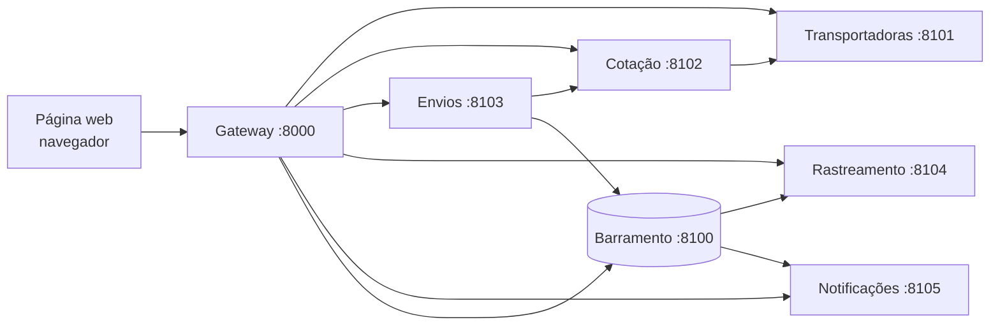

# Atividade: Processo de Análise de Requisitos para Geração de Código com LLM

## Entregáveis

| # | Entregável | Arquivo |
|---|---|---|
| 1 | Processo ERL (Especificação de Requisitos para LLM), para microsserviços | [`entregaveis/1-processo.md`](entregaveis/1-processo.md) |
| 2 | Artefato: modelo do documento de requisitos | [`entregaveis/2-modelo-documento-requisitos.md`](entregaveis/2-modelo-documento-requisitos.md) |
| 3 | Instruções de preenchimento e checklist | [`entregaveis/3-instrucoes-preenchimento.md`](entregaveis/3-instrucoes-preenchimento.md) |
| 4 | Relatório técnico do experimento | [`entregaveis/4-relatorio-tecnico.md`](entregaveis/4-relatorio-tecnico.md) |
| 5 | Módulo de logística de entregas: visão completa (arquitetura, regras, fluxos) | [`entregaveis/5-modulo-logistica.md`](entregaveis/5-modulo-logistica.md) |

## Experimento: módulo de logística em microsserviços

| O quê | Onde |
|---|---|
| Documento de requisitos no modelo ERL (o que a LLM recebe) | `experimento/especificacoes/ERS-LOG-001.md` |
| Especificação narrativa (grupo de controle) | `experimento/especificacoes/logistica-narrativa.md` |
| Barramento de eventos (infraestrutura fornecida) | `experimento/infra/barramento.py` |
| Implementação de referência dos 5 serviços (valida o oráculo) | `experimento/referencia/servicos/` |
| Oráculo: um teste HTTP por critério de aceitação; harness que sobe os serviços como processos | `experimento/testes/` |
| Geração, registro e medição | `experimento/executar.py` |
| Estatística | `experimento/analisar.py` |
| Dados brutos e código gerado | `experimento/resultados/` |

Para reproduzir (Windows):

```bash
cd experimento
py -m venv .venv
.venv/Scripts/python -m pip install -r requirements.txt
.venv/Scripts/python -m pytest testes -q          # sobe os 6 processos e roda os 77 critérios contra a referência
.venv/Scripts/python executar.py validar          # oráculo: referência 100%, sistema vazio 0%, mutantes detectados
.venv/Scripts/python executar.py registrar        # avalia o código gerado em resultados/<condicao>/<NN>/servicos/
.venv/Scripts/python analisar.py                  # gera resultados/resumo.md
```

O código gerado pela LLM é executado localmente pelos testes. Rode numa máquina que você controla.

## Demonstração

A demonstração mostra o módulo de logística funcionando de verdade, com uma página web por cima. Por padrão, ela roda o **código gerado pela LLM** na execução `resultados/erl/01`, e não a implementação de referência: o que aparece na tela é o sistema que a IA escreveu a partir do documento de requisitos, sem nenhuma edição manual.

### Como rodar

```bash
cd experimento
.venv/Scripts/python demo/subir.py                                   # código gerado pela LLM (erl/01)
.venv/Scripts/python demo/subir.py --alvo referencia                 # implementação de referência
.venv/Scripts/python demo/subir.py --alvo resultados/narrativa/07    # qualquer outra execução
```

Depois, abra **http://127.0.0.1:8000** no navegador. **Ctrl+C** no terminal derruba tudo. A demonstração não usa a API do Claude nem gasta tokens.

### O que sobe



| Processo | Porta | Papel |
|---|---|---|
| Barramento | 8100 | Repassa os eventos de Envios para Rastreamento e Notificações (infraestrutura fornecida) |
| Transportadoras, Cotação, Envios, Rastreamento, Notificações | 8101 a 8105 | Os 5 microsserviços, cada um num processo separado, com o Swagger em `/docs` |
| Gateway | 8000 | Serve a página e repassa as chamadas dela para os serviços |

O gateway existe porque o navegador bloqueia uma página que chama vários endereços diferentes (CORS), e os serviços não liberam esse acesso. Ele funciona como um *API gateway*, padrão comum em microsserviços: um único ponto de entrada para os clientes. Ao subir, o script cadastra quatro transportadoras de exemplo (Rápida Log, Econômica Express, Expressa Já e SuLog). O código está em `experimento/demo/subir.py` e `experimento/demo/index.html`.

### O que a página mostra

| Área | O que acontece | Serviços envolvidos |
|---|---|---|
| Topo | Situação dos 6 processos (verde = no ar), **relógio simulado** e botão para reiniciar | todos |
| 1. Cotação de frete | Escolha origem, destino e pacote. Aparece um cartão por transportadora elegível, com preço, prazo em dias úteis, data prevista e os selos "mais barata" e "mais rápida" | Cotação → Transportadoras |
| 2. Cliente escolhe | O cliente escolhe **qualquer** transportadora (não precisa ser a mais barata) e finaliza a compra, criando o envio | Envios → Cotação |
| 3. Painel da transportadora | Simula a transportadora informando as etapas. Os botões destacados são as transições válidas; os outros podem ser clicados para mostrar o sistema recusando a operação (HTTP 409) | Envios |
| Eventos no barramento | Cada evento publicado por Envios, na ordem em que aconteceu | Barramento |
| 4. Rastreamento | Linha do tempo do envio, com alerta de atraso e de entregue | Rastreamento (alimentado por eventos) |
| Notificações | Mensagens enviadas ao cliente | Notificações (alimentado por eventos) |

O sistema não lê a hora do computador: toda data chega na requisição (regra RT-06 do documento). Por isso a página tem um **relógio simulado**. Ele começa em segunda-feira, 02/03/2026, 09:00, avança sozinho a cada etapa da transportadora (3 horas, 8 horas ou 1 dia, à escolha) e pode avançar 1 dia pelo botão "+1 dia".

### Roteiro sugerido para a apresentação

1. **Cotação:** São Paulo → Rio de Janeiro com o pacote padrão. Aparecem duas opções; a Expressa Já não atende o RJ e fica de fora.
2. **Escolha do cliente:** escolha a **Rápida Log**, que é a mais cara e a mais rápida. O sistema respeita a escolha.
3. **Transição inválida:** logo depois de criar o envio, clique em "Entregar". Aparece `HTTP 409 — TRANSICAO_INVALIDA`, porque um envio não pode ser entregue antes de ser coletado.
4. **Fluxo normal:** Coletar → Em trânsito → Saiu para entrega. Acompanhe o rastreamento, as notificações e os eventos atualizando sozinhos.
5. **Devolução automática:** registre três "Falha na entrega", com "Saiu para entrega" entre elas. Na terceira, o envio vai sozinho para **DEVOLVIDO**.
6. **Atraso:** em outro envio, avance o relógio com "+1 dia" até passar da data prevista. O rastreamento mostra o alerta de atraso.
7. **Outras regras:** com um pacote de 50 kg, só a Econômica aparece (peso máximo). Com destino em Manaus, a cotação dá `CEP_FORA_DA_AREA`.

### O que observar

- **Notificações seletivas:** coletado e em trânsito aparecem no rastreamento, mas **não** geram notificação (regra RN-15).
- **Eventos autocontidos:** Rastreamento e Notificações nunca chamam o serviço Envios; tudo o que eles mostram chega pelos eventos do barramento.
- **Contrato respeitado:** a página só funciona porque o código gerado usa exatamente as rotas, os campos e os códigos de erro do documento de requisitos. Ela foi escrita a partir do documento, e não a partir do código gerado.
- **Swagger:** para mostrar as APIs "por dentro", abra `http://127.0.0.1:8101/docs` a `http://127.0.0.1:8105/docs`.

## Estudo preliminar

O primeiro ciclo do processo usou um sistema pequeno (biblioteca, módulo único) e está arquivado em [`estudo-preliminar/`](estudo-preliminar/), com o relatório próprio. O resultado (100% em todas as execuções, nas duas condições) motivou a troca por um sistema maior e distribuído.

Decisões de projeto: [`docs/decisoes/`](docs/decisoes/).

---

## Descrição da Atividade

Cada grupo deverá:

- Desenvolver e descrever um processo de análise de requisitos;
- Desse processo, deve surgir um padrão de documento (formato em Markdown);
- Esse documento, se utilizado em uma IA LLM, deve gerar o código de acordo com o documento de requisitos com conformidade **igual ou superior a 85%**.

## Entregáveis

Ao final, o grupo deve entregar:

1. **Processo**;
2. **Artefato** (modelo do documento de requisitos);
3. **Instruções** para o preenchimento do documento de requisitos;
4. **Relatório técnico do experimento** (método científico de teste de hipótese) realizado com o modelo, que apresente o resultado de conformidade entre documento e produto de software igual ou superior a 85%.

---

## Objetivo Geral

Desenvolver um processo estruturado de análise e especificação de requisitos capaz de gerar um documento padronizado em Markdown, utilizável por uma LLM para produzir software com conformidade mínima de 85% em relação aos requisitos definidos.

## Objetivos Específicos

- Estruturar um processo de análise de requisitos.
- Criar um modelo padronizado de documento de requisitos.
- Definir instruções claras para seu preenchimento.
- Utilizar LLMs para geração de código a partir da especificação.
- Estabelecer critérios e métricas de conformidade.
- Aplicar método científico para testar a hipótese proposta.
- Analisar os resultados e propor melhorias no processo e no artefato.

---

## Metodologias

- Aprendizagem Baseada em Projetos.
- Aprendizagem Baseada em Problemas.
- Aprendizagem Colaborativa.
- Experimentação prática.
- Método científico.
- Design iterativo com ciclos de teste, análise e melhoria.

---

## Capacidades

### Capacidades Básicas

- Interpretação e análise de problemas.
- Raciocínio lógico e crítico.
- Comunicação e documentação técnica.
- Pesquisa e organização de informações.
- Análise de dados e resultados.
- Resolução de problemas.

### Capacidades Técnicas

- Engenharia e análise de requisitos.
- Especificação e validação de requisitos.
- Definição de requisitos funcionais, não funcionais e critérios de aceitação.
- Documentação em Markdown.
- Engenharia de prompts e contexto para LLMs.
- Geração e avaliação de código com IA.
- Testes e validação de software.
- Definição de métricas de conformidade.
- Método científico aplicado à Engenharia de Software.

### Capacidades Socioemocionais

- Trabalho em equipe.
- Comunicação e colaboração.
- Autonomia e responsabilidade.
- Gestão do tempo.
- Tomada de decisão.
- Criatividade e adaptabilidade.
- Pensamento crítico e abertura à revisão de hipóteses.

---

## Benefícios para a Sociedade

A atividade contribui para a formação de profissionais capazes de desenvolver softwares com maior qualidade, confiabilidade e aderência às necessidades dos usuários. Também estimula o uso responsável da Inteligência Artificial, a redução de erros e retrabalho, o aumento da produtividade no desenvolvimento de software e a criação de processos mais eficientes de interação entre pessoas, requisitos e sistemas de IA.
