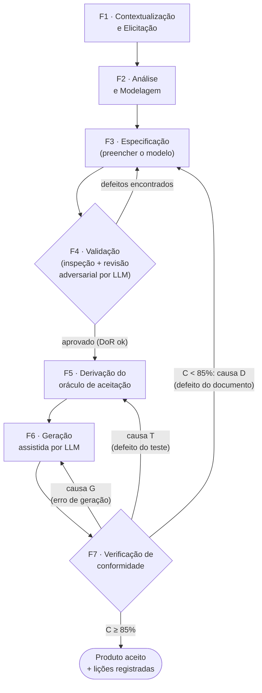

# Entregável 1 — Processo PRECISA de Análise de Requisitos

**PRECISA** — *Processo de Requisitos Estruturados, Claros e Inequívocos para Software Assistido por IA*.

| Item | Valor |
|---|---|
| Versão do processo | 1.0 |
| Artefato produzido | [Modelo de Especificação de Requisitos PRECISA](2-modelo-documento-requisitos.md) |
| Instruções de uso do artefato | [Instruções de preenchimento](3-instrucoes-preenchimento.md) |
| Evidência experimental | [Relatório técnico do experimento](4-relatorio-tecnico.md) |
| Referências-base | ISO/IEC/IEEE 29148:2018 (características de bons requisitos), EARS (Mavin et al., 2009), BDD/Gherkin (critérios Dado/Quando/Então), RFC 2119 (palavras normativas), ISO/IEC 25010 (qualidade de produto) |

---

## 1. Propósito

O PRECISA define **como transformar uma necessidade de negócio em um documento de requisitos em Markdown que uma LLM consiga implementar com conformidade ≥ 85%**, e como **medir** essa conformidade.

A premissa central do processo é:

> **Uma LLM não pergunta — ela supõe.** Diante de uma lacuna, ambiguidade ou contradição, a LLM preenche o vazio com a suposição estatisticamente mais provável, que nem sempre é a desejada. Cada lacuna no documento é, portanto, um ponto potencial de não conformidade.

Por isso o processo concentra esforço **antes** da geração de código: elimina lacunas, fixa a interface, transforma regras em exemplos concretos e deriva os testes de aceitação a partir do próprio documento.

## 2. Princípios

| # | Princípio | Consequência prática |
|---|---|---|
| P1 | **Nada implícito** | Tudo o que o código precisa decidir (nomes, tipos, ordem de validação, arredondamento, limites, ordenação) está escrito. |
| P2 | **Interface é contrato** | Nomes de arquivos, classes, funções, parâmetros, tipos e erros são fixados antes da geração. Sem isso não há como verificar o produto. |
| P3 | **Requisito = regra + exemplo** | Toda regra de negócio vem acompanhada de pelo menos um critério de aceitação com valores concretos. |
| P4 | **Verificável ou não é requisito** | Requisito não funcional sem métrica e método de verificação é rejeitado na validação. |
| P5 | **Testes antes do código** | O oráculo de testes é derivado dos critérios de aceitação *antes* da geração — e nunca é mostrado à LLM. |
| P6 | **Rastreabilidade total** | Cada critério aponta para um requisito; cada requisito aponta para operação(ões) da interface e regra(s) de negócio. |
| P7 | **Melhoria por evidência** | Cada não conformidade é classificada por causa-raiz e retroalimenta o documento, o modelo ou o processo. |

## 3. Papéis

| Papel | Responsabilidades | Fases |
|---|---|---|
| **Cliente / Product Owner (PO)** | Fornece necessidades, decide prioridades, aprova a especificação. | F1, F2, F4 |
| **Analista de Requisitos** | Conduz elicitação, modela o domínio, preenche o modelo, mantém a rastreabilidade. | F1–F4, F7 |
| **Revisor(a)** | Inspeciona o documento com o checklist de qualidade; conduz a revisão adversarial com LLM. Não pode ser o autor do documento. | F4 |
| **Engenheiro(a) de Testes** | Deriva o oráculo de testes dos critérios de aceitação; valida o oráculo com uma implementação de referência. | F5, F7 |
| **Operador(a) de LLM** | Executa a geração seguindo o protocolo (prompt padrão, sessão nova, sem edição manual). | F6 |

Em grupos pequenos uma pessoa acumula papéis, **exceto** Autor × Revisor e Engenheiro de Testes × Operador de LLM, que devem ser pessoas diferentes (independência da verificação).

## 4. Visão geral do fluxo

## 5. Fases

### F1 — Contextualização e Elicitação

| Aspecto | Descrição |
|---|---|
| **Objetivo** | Entender o problema, o contexto e as necessidades das partes interessadas. |
| **Entradas** | Demanda inicial do cliente; documentos existentes (formulários, planilhas, normas, sistemas legados). |
| **Atividades** | 1. Identificar partes interessadas e atores. 2. Realizar entrevistas/reuniões curtas guiadas pelas **perguntas-chave** abaixo. 3. Coletar exemplos reais (casos, números, documentos). 4. Registrar necessidades brutas numeradas (N-01, N-02…). 5. Delimitar o escopo: o que está **dentro** e **fora**. |
| **Técnicas** | Entrevista semiestruturada, análise de documentos, brainstorming, observação, **especificação por exemplos** (pedir ao cliente casos concretos: "me dê um exemplo em que isso acontece"). |
| **Saídas** | Lista de necessidades (N-xx); lista de atores; escopo preliminar; exemplos concretos coletados. |
| **Critério de saída** | Toda necessidade tem origem (quem pediu) e ao menos um exemplo concreto. |

**Perguntas-chave da elicitação** (cada resposta vira conteúdo do modelo):

1. Quem usa o sistema e o que cada ator precisa conseguir fazer?
2. Quais dados entram, com que formato, e quais são inválidos?
3. Quais são os limites numéricos (máximos, mínimos, prazos, valores)?
4. O que acontece quando algo dá errado? Qual erro deve ser informado?
5. Se duas regras falharem ao mesmo tempo, qual erro prevalece?
6. Há cálculo? Qual a fórmula, a unidade e o arredondamento?
7. Há listagens? Em que ordem e com que critério de desempate?
8. Em que tecnologia/linguagem o software deve ser entregue? Há restrições de bibliotecas?
9. O que, explicitamente, **não** faz parte do sistema?

### F2 — Análise e Modelagem

| Aspecto | Descrição |
|---|---|
| **Objetivo** | Transformar necessidades brutas em um modelo consistente do domínio, sem ambiguidades nem conflitos. |
| **Entradas** | Saídas de F1. |
| **Atividades** | 1. Construir o **glossário** (um termo = um significado; sinônimos proibidos). 2. Modelar **entidades e atributos** com tipo, restrição e valor padrão. 3. Extrair **regras de negócio** (RN-xx) atômicas, com fórmulas e valores. 4. Agrupar necessidades em **requisitos funcionais** (RF-xx) e não funcionais (RNF-xx). 5. Definir o **contrato de interface** (operações, assinaturas, erros). 6. Para cada operação, definir a **ordem de validação** dos erros. 7. Detectar e resolver **conflitos** e **lacunas** com o PO (registrar decisões). 8. Priorizar (MoSCoW). |
| **Técnicas** | Modelagem de domínio, tabelas de decisão, análise de valores-limite, análise de casos de uso, matriz de conflitos, MoSCoW. |
| **Saídas** | Glossário; modelo de dados; lista de RN, RF, RNF priorizada; esboço do contrato de interface; registro de decisões. |
| **Critério de saída** | Nenhum conflito aberto; todo RF ligado a ≥ 1 necessidade; toda RN tem valores concretos. |

> **Dica de análise:** para cada operação, monte uma pequena tabela de decisão "condição → resultado". As linhas da tabela viram, quase diretamente, os critérios de aceitação de F3.

### F3 — Especificação (preenchimento do modelo)

| Aspecto | Descrição |
|---|---|
| **Objetivo** | Registrar o resultado da análise no [modelo PRECISA](2-modelo-documento-requisitos.md), em linguagem que uma LLM implemente sem supor nada. |
| **Entradas** | Saídas de F2. |
| **Atividades** | 1. Preencher as seções do modelo na ordem das [instruções](3-instrucoes-preenchimento.md). 2. Redigir requisitos com **padrões EARS** e palavras normativas (DEVE / NÃO DEVE / PODE). 3. Escrever critérios de aceitação **Dado/Quando/Então** com valores concretos, cobrindo caminho feliz, cada erro e cada valor-limite. 4. Preencher a matriz de rastreabilidade. 5. Executar a autoverificação do checklist de prontidão (DoR). |
| **Técnicas** | EARS, Gherkin/BDD, especificação por exemplos, análise de valores-limite e partição de equivalência. |
| **Saídas** | Documento de Especificação de Requisitos (ERS) versão "Em revisão". |
| **Critério de saída** | Todas as seções obrigatórias preenchidas; DoR autoverificado pelo autor. |

### F4 — Validação da especificação

| Aspecto | Descrição |
|---|---|
| **Objetivo** | Encontrar defeitos no documento **antes** que virem defeitos no código. |
| **Entradas** | ERS "Em revisão". |
| **Atividades** | 1. **Inspeção humana** com o checklist de qualidade (seção 7 das instruções) — revisor ≠ autor. 2. **Revisão adversarial por LLM**: submeter o documento a uma LLM com o *prompt de revisão* (seção 8 das instruções), pedindo que liste ambiguidades, omissões, contradições e suposições que ela faria. 3. Triar cada achado: *aceito* (corrigir em F3) ou *rejeitado* (justificar). 4. Obter aprovação do PO. |
| **Técnicas** | Inspeção baseada em checklist, leitura baseada em perspectiva (usuário, testador, implementador), revisão adversarial por LLM. |
| **Saídas** | Lista de defeitos e decisões; ERS versão "Aprovado". |
| **Critério de saída** | Zero achados abertos de severidade alta; checklist DoR 100% atendido; aprovação do PO registrada no histórico de revisões. |

> A revisão adversarial explora o próprio comportamento da LLM: tudo o que ela declarar como "suposição que eu faria" é exatamente o que ela inventaria na geração. Cada suposição listada deve virar texto explícito no documento.

### F5 — Derivação do oráculo de aceitação

| Aspecto | Descrição |
|---|---|
| **Objetivo** | Converter os critérios de aceitação em testes automatizados que medem a conformidade objetivamente. |
| **Entradas** | ERS "Aprovado". |
| **Atividades** | 1. Para cada critério (CA/CV) escrever ≥ 1 teste automatizado, identificado pelo ID do critério. 2. Validar o oráculo contra uma **implementação de referência** escrita por humanos (deve obter 100%). 3. Revisar se algum teste verifica algo **não escrito** no documento (proibido — invalida a medição). 4. Armazenar os testes fora do alcance da LLM. |
| **Técnicas** | Testes de aceitação automatizados, rastreabilidade critério ↔ teste. |
| **Saídas** | Suíte de testes de aceitação (oráculo) validada; implementação de referência. |
| **Critério de saída** | 100% dos critérios cobertos por testes; referência aprova 100%; nenhum teste sem critério correspondente. |

### F6 — Geração assistida por LLM

| Aspecto | Descrição |
|---|---|
| **Objetivo** | Produzir o código a partir **somente** do documento. |
| **Entradas** | ERS "Aprovado"; prompt padrão de geração. |
| **Atividades** | 1. Abrir **sessão nova** (sem memória/histórico). 2. Enviar o prompt padrão + documento completo. 3. Salvar a resposta sem nenhuma edição humana. 4. Registrar metadados (modelo, versão, data, parâmetros). |
| **Técnicas** | Engenharia de prompt (prompt padrão fixo), engenharia de contexto (o documento é o contexto). |
| **Saídas** | Código gerado + registro da execução. |
| **Critério de saída** | Código salvo exatamente como gerado; registro preenchido. |

### F7 — Verificação de conformidade e retroalimentação

| Aspecto | Descrição |
|---|---|
| **Objetivo** | Medir a conformidade e transformar falhas em melhorias. |
| **Entradas** | Código gerado; oráculo validado. |
| **Atividades** | 1. Executar o oráculo e calcular a **conformidade C** (ver seção 7). 2. Para cada critério reprovado, classificar a causa-raiz (D, G ou T — ver seção 8). 3. Aplicar a ação corretiva correspondente. 4. Registrar lições aprendidas e, quando o defeito for recorrente, propor alteração no **modelo** ou nas **instruções**. |
| **Técnicas** | Execução de testes automatizados, análise de causa-raiz, estatística descritiva e inferencial. |
| **Saídas** | Relatório de conformidade; lista de causas-raiz; propostas de melhoria. |
| **Critério de saída** | C ≥ 85% **ou** ciclo de correção iniciado. |

## 6. Artefatos do processo

| Artefato | Produzido em | Formato | Modelo / exemplo |
|---|---|---|---|
| Lista de necessidades (N-xx) | F1 | Markdown (tabela) | seção 2 do modelo (Contexto) |
| Glossário, modelo de dados, RN | F2 | Markdown | seções 3, 5 e 7 do modelo |
| **Documento de Especificação de Requisitos (ERS)** | F3/F4 | Markdown | [modelo](2-modelo-documento-requisitos.md) · [exemplo preenchido](../experimento/especificacao/ERS-BIB-001.md) |
| Relatório de validação | F4 | Markdown | seção 14 do modelo (histórico) |
| Oráculo de aceitação | F5 | Código de teste | [testes_aceitacao.py](../experimento/avaliacao/testes_aceitacao.py) |
| Implementação de referência | F5 | Código | [referencia/biblioteca.py](../experimento/referencia/biblioteca.py) |
| Código gerado + registro | F6 | Código + CSV | [experimento/execucoes](../experimento/execucoes/) |
| Relatório de conformidade | F7 | Markdown/CSV | gerado por [avaliar.py](../experimento/avaliacao/avaliar.py) |

## 7. Métrica de conformidade

**Definição.** Seja *K* o número total de critérios verificáveis do documento (critérios de aceitação funcionais **CA** + critérios de verificação não funcionais **CV**). Um critério é **atendido** quando *todos* os testes associados a ele passam. A conformidade de uma execução *i* é:

$$C_i = \frac{\text{critérios atendidos na execução } i}{K}$$

**Meta:** $C_i \geq 0{,}85$, e, no experimento, evidência estatística de que a conformidade média $\mu > 0{,}85$.

**Métricas auxiliares do processo:**

| Métrica | Fórmula | Uso |
|---|---|---|
| Cobertura do oráculo | critérios com teste ÷ critérios totais | Deve ser 100% ao fim de F5. |
| Densidade de achados na validação | achados aceitos em F4 ÷ nº de requisitos | Indica maturidade do documento; tende a cair a cada ciclo. |
| Taxa de falha por critério | execuções que reprovam o critério ÷ execuções | Aponta os pontos frágeis do documento (insumo de F7). |
| Proporção de causas D/G/T | contagem por causa ÷ total de falhas | Indica onde agir: documento, geração ou testes. |

## 8. Ciclo de melhoria (causa-raiz das não conformidades)

| Código | Causa-raiz | Pergunta diagnóstica | Ação corretiva | Volta para |
|---|---|---|---|---|
| **D** | **Defeito do documento** — ambiguidade, omissão, contradição | "Uma pessoa competente, lendo só o documento, poderia ter chegado ao mesmo resultado que a LLM?" Se **sim**, é D. | Reescrever o trecho; acrescentar CA com exemplo; se o padrão se repetir, alterar o **modelo** ou as **instruções**. | F3 |
| **G** | **Erro de geração** — o documento é claro, a LLM errou | "O documento diz isso de forma explícita e única?" Se **sim**, é G. | Reforçar no texto (ex.: mover para a seção de Convenções Gerais, destacar com **NÃO DEVE**); avaliar outro modelo de LLM. | F6 |
| **T** | **Defeito do oráculo** — o teste verifica algo que o documento não diz, ou verifica errado | "O teste exige algo que não está escrito?" Se **sim**, é T. | Corrigir o teste e revalidá-lo contra a referência. Resultados medidos com o teste defeituoso são descartados e reprocessados. | F5 |

## 9. Adaptação (tailoring)

- **Projetos pequenos** (até ~10 RF): F1 e F2 podem ser feitas numa única sessão; a revisão adversarial por LLM continua obrigatória.
- **Linguagem/plataforma**: o modelo é independente de linguagem; apenas a seção de Contrato de Interface muda de forma (ex.: endpoints REST em vez de métodos de classe).
- **Sem automação de testes**: o oráculo pode ser uma planilha de verificação manual por critério, mas isso reduz a objetividade e deve constar como ameaça à validade.
