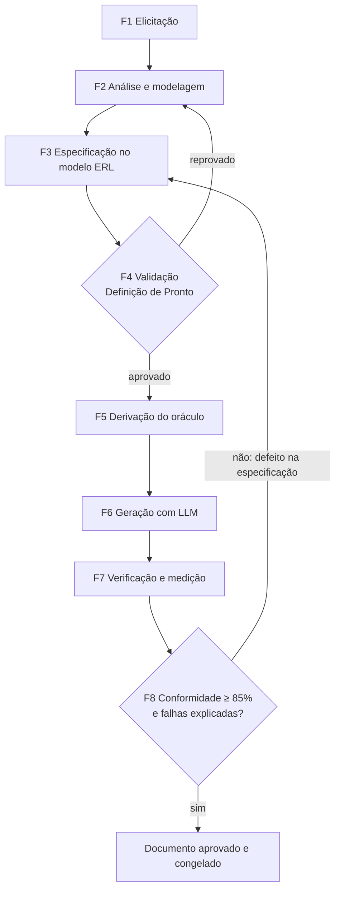

# Processo ERL — Especificação de Requisitos para LLM

## 1. Propósito

O processo ERL transforma uma necessidade de software num documento de requisitos em Markdown (o **artefato**, `2-modelo-documento-requisitos.md`) que uma LLM consegue implementar com conformidade de pelo menos 85%. A conformidade é medida objetivamente: cada requisito tem critérios de aceitação, e cada critério vira um teste automático.

### 1.1 Por que um processo específico para LLM

Uma pessoa desenvolvedora que recebe um requisito ambíguo pergunta ao analista. Uma LLM não pergunta: ela **escolhe** uma interpretação e segue em frente. Por isso a especificação precisa fechar, antes da geração, as decisões que normalmente se resolvem em conversa. Quando o documento não fecha essas decisões, a não conformidade costuma vir de quatro fontes (os mutantes usados na fase F5 imitam exatamente essas falhas):

| Fonte de não conformidade | Exemplo | Como o processo a elimina |
|---|---|---|
| Interface divergente | A LLM chama o método de `realizar_emprestimo` em vez de `emprestar`, ou devolve `float` em vez de `int` | Contrato de interface exato (Seção 5 do modelo), definido na fase F2 |
| Regra implícita | "O aluno tem prazo de duas semanas": 14 dias corridos ou úteis? Conta a partir de quando? | Regra atômica com valores (Seção 6) e glossário (Seção 2) |
| Prioridade entre erros | O usuário está bloqueado **e** no limite: qual exceção vem primeiro? | Tabela de ordem de validação em cada RF |
| Fronteira | Devolver **na** data prevista gera multa? | Critérios de aceitação com valores concretos, incluindo os limites |

O processo se apoia nas atividades clássicas da engenharia de requisitos (elicitação, análise, especificação e validação) e nas características de um bom requisito da ISO/IEC/IEEE 29148: necessário, não ambíguo, verificável, singular, consistente, completo e rastreável. Ele acrescenta três coisas: o contrato de interface, o **oráculo** de testes derivado dos critérios e um ciclo de retroalimentação que mede a conformidade e corrige o documento.

## 2. Papéis

| Papel | Responsabilidade |
|---|---|
| Cliente (dono do produto) | Fornece a necessidade, responde às questões em aberto e aprova o escopo |
| Analista | Conduz a elicitação e a análise e preenche o documento |
| Revisor | Outra pessoa do grupo; valida o documento pelo checklist da fase F4 sem ter participado da escrita |
| Testador | Escreve o oráculo (testes de aceitação) a partir dos critérios, sem olhar código gerado |

Num grupo pequeno, uma pessoa pode acumular papéis, **exceto** analista e revisor do mesmo documento: quem escreveu não enxerga as próprias ambiguidades.

## 3. Visão geral

Cada fase tem entrada, atividades, saída e um critério de saída. Uma fase só termina quando o critério de saída é cumprido.

## 4. Fases

### F1 — Elicitação

- **Entrada:** a necessidade do cliente (conversa, enunciado, sistema legado).
- **Atividades:**
  1. Entrevistar o cliente com o roteiro: objetivo, atores, o que o sistema faz, o que **não** faz, regras com números (prazos, limites, valores), erros possíveis e exemplos reais.
  2. Para cada regra mencionada, pedir **um exemplo com números**: "se o aluno pega o livro no dia 2 e devolve no dia 19, quanto paga?". O exemplo pega ambiguidades que a frase esconde.
  3. Registrar tudo em notas brutas, sem filtrar.
- **Saída:** notas de elicitação e lista inicial de exemplos.
- **Critério de saída:** todo ator e toda capacidade citada pelo cliente tem pelo menos um exemplo numérico.

### F2 — Análise e modelagem

- **Entrada:** notas da F1.
- **Atividades:**
  1. **Glossário:** listar os substantivos do domínio e dar a cada um uma definição única. Eliminar sinônimos ("leitor", "usuário", "cliente" viram um só termo).
  2. **Modelo de dados:** transformar os substantivos em entidades com campos, tipos e restrições verificáveis.
  3. **Contrato de interface:** decidir como o software será usado e testado (classe e métodos, endpoints HTTP, linha de comando), com nomes, parâmetros, tipos de retorno e erros. É a decisão que mais pesa na conformidade, porque é por ela que o oráculo enxerga o software.
  4. **Regras de negócio:** decompor as regras em frases atômicas (uma regra, um fato), com valores concretos. Escrever também as **permissões** ("é permitido ter dois exemplares do mesmo livro"), porque a ausência de regra é ambígua.
  5. **Escopo negativo:** listar o que fica fora (persistência, interface, autenticação...) para a LLM não inventar.
  6. **Questões em aberto:** toda dúvida vira uma linha na Seção 11 e volta ao cliente.
- **Saída:** glossário, modelo de dados, contrato, regras e escopo.
- **Critério de saída:** nenhuma questão em aberto sem resposta do cliente.

### F3 — Especificação no modelo ERL

- **Entrada:** saídas da F2.
- **Atividades:** preencher o modelo seguindo `3-instrucoes-preenchimento.md`. Para cada operação do contrato, escrever um RF com ordem de validação e critérios de aceitação (`CA`) no formato Dado/Quando/Então, com valores concretos. Cada CA cobre um caminho: o feliz, cada erro e cada fronteira de regra numérica.
- **Saída:** documento de requisitos preenchido (Situação: Rascunho).
- **Critério de saída:** todas as seções preenchidas e matriz de rastreabilidade completa.

### F4 — Validação (Definição de Pronto)

- **Entrada:** documento em Rascunho.
- **Atividades:**
  1. O revisor aplica o checklist da Seção 7 de `3-instrucoes-preenchimento.md`, item por item.
  2. **Leitura adversarial:** para cada RF, o revisor tenta achar duas implementações diferentes que satisfaçam o texto. Se achar, o texto é ambíguo e volta para a F3 com a correção.
  3. O revisor confere, à mão, que cada CA é consistente com as regras (refaz as contas de datas e valores).
- **Saída:** documento com Situação "Pronto para geração", ou lista de defeitos.
- **Critério de saída:** checklist 100% atendido.

### F5 — Derivação do oráculo

- **Entrada:** documento pronto.
- **Atividades:**
  1. O testador escreve **um teste automático por CA**, com o nome igual ao id do CA (`CA-RF03-07` → `test_CA_RF03_07`). O teste usa só a interface pública da Seção 5.
  2. **Validação do oráculo:** quando houver uma implementação de referência, todos os testes precisam passar nela. Um arquivo vazio precisa passar em 0. E defeitos injetados de propósito (mutantes: um prazo trocado, uma ordem de validação invertida) precisam ser detectados. Sem isso, não dá para saber se uma falha é da LLM ou do teste.
- **Saída:** suíte de testes de aceitação validada.
- **Critério de saída:** um teste por CA, referência com 100% e todos os mutantes detectados.

### F6 — Geração com LLM

- **Entrada:** documento pronto e um prompt fixo.
- **Atividades:** enviar à LLM o prompt fixo com o documento inteiro. O prompt não acrescenta requisitos: só pede a implementação e o formato de saída. Registrar modelo, versão, parâmetros e data.
- **Saída:** código gerado.
- **Critério de saída:** o código foi extraído da resposta e salvo sem edição manual.

### F7 — Verificação e medição

- **Entrada:** código gerado e oráculo.
- **Atividades:** rodar o oráculo sobre o código e calcular a conformidade:

  > **Conformidade = CAs aprovados ÷ total de CAs do documento**

  Uma resposta sem código, truncada ou recusada conta como conformidade 0. Um teste que não roda (erro de importação, tempo esgotado) conta como reprovado.
- **Saída:** conformidade e lista dos CAs reprovados.
- **Critério de saída:** medição registrada.

### F8 — Retroalimentação

- **Entrada:** CAs reprovados.
- **Atividades:** classificar a causa de cada reprovação:

  | Causa | Pergunta de diagnóstico | Ação |
  |---|---|---|
  | Defeito de especificação: ambiguidade | Existe leitura razoável do texto que leva ao comportamento gerado? | Corrigir o documento (volta à F3) e registrar a lição no modelo ou nas instruções |
  | Defeito de especificação: omissão | O comportamento esperado está escrito em algum lugar? | Idem |
  | Defeito do oráculo | O teste cobra algo diferente do CA? | Corrigir o teste e revalidar (F5) |
  | Defeito de geração | O texto é claro e a LLM errou mesmo assim? | Registrar; não muda o documento |

  Só as duas primeiras causas mudam o documento. Mexer no documento para compensar um erro aleatório da LLM o deixaria preso a uma execução específica.
- **Saída:** documento revisado ou aprovado, e o registro das lições aprendidas.
- **Critério de saída:** conformidade ≥ 85% e toda reprovação classificada.

## 5. Artefatos produzidos

| Artefato | Fase | Onde fica no repositório |
|---|---|---|
| Modelo do documento | — | `entregaveis/2-modelo-documento-requisitos.md` |
| Instruções de preenchimento e checklist | — | `entregaveis/3-instrucoes-preenchimento.md` |
| Documento de requisitos preenchido | F3–F4 | `experimento/especificacoes/biblioteca-modelo-erl.md` |
| Oráculo (testes de aceitação) | F5 | `experimento/testes/test_aceitacao.py` |
| Implementação de referência | F5 | `experimento/referencia/biblioteca.py` |
| Prompt fixo | F6 | `experimento/prompt.txt` |
| Registro de execuções e conformidade | F7 | `experimento/resultados/execucoes.csv` |
| Relatório do experimento | F8 | `entregaveis/4-relatorio-tecnico.md` |

## 6. Iteração

O processo é iterativo. A primeira passagem pela F6–F8 é um **piloto** com poucas execuções (5 bastam), feito para achar defeitos de especificação antes de gastar a amostra principal. Depois do piloto, o documento e o oráculo são **congelados** e o experimento principal roda sem nenhuma alteração. Mudar o documento no meio do experimento misturaria duas versões na mesma amostra. As lições de cada ciclo voltam para o modelo e para as instruções, e é assim que o artefato melhora de um projeto para o seguinte.
