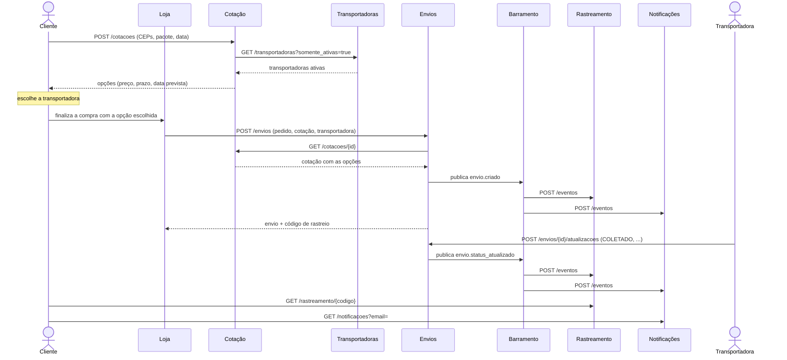
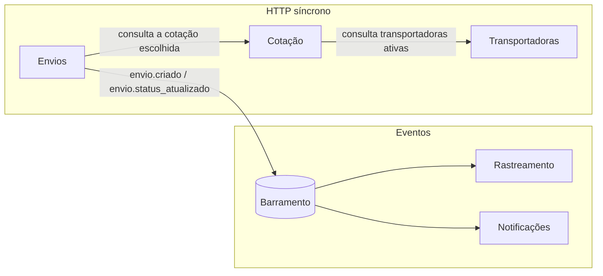
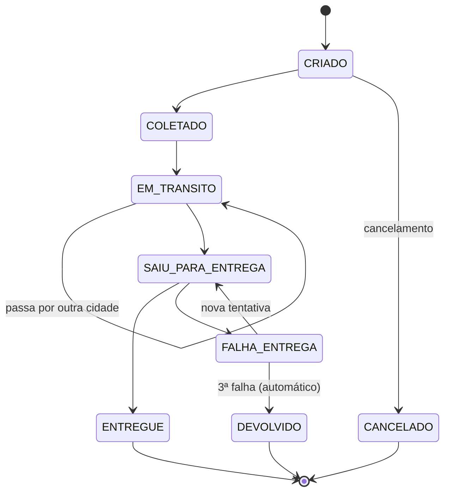

# Módulo de Logística de Entregas — Visão completa

Este documento explica o módulo de logística usado como objeto do experimento: o que ele faz, como é dividido em microsserviços, por que foi dividido assim, como os serviços conversam e quais são as regras de negócio. A especificação formal, que é o documento entregue à LLM, está em [`experimento/especificacoes/ERS-LOG-001.md`](../experimento/especificacoes/ERS-LOG-001.md). Aqui está o raciocínio por trás dela.

---

## 1. O problema de negócio

Num marketplace como o Mercado Livre ou a Amazon, o vendedor anuncia, o cliente compra e uma **transportadora parceira** leva o produto até a casa do cliente. A logística tem de responder a quatro perguntas:

1. **Quanto custa e quanto demora para entregar este pacote neste endereço?** Cotação de frete.
2. **Com quem vai?** O cliente compara as opções e **escolhe a transportadora**.
3. **Onde está meu pedido?** Rastreamento.
4. **Como eu fico sabendo?** Notificações.

O módulo cobre essas quatro perguntas, mais o cadastro das transportadoras que tornam a cotação possível.

### 1.1 Jornada do cliente



---

## 2. Arquitetura

### 2.1 Os cinco serviços

| Serviço | Responsabilidade | Dono dos dados | Fala com |
|---|---|---|---|
| **Transportadoras** | Cadastro das parceiras: área atendida, tabela de preço, prazo, peso máximo, ativa/inativa | Transportadoras | ninguém |
| **Cotação** | Calcula o frete por transportadora e guarda a cotação por 7 dias | Cotações | Transportadoras (HTTP) |
| **Envios** | Cria o envio com a transportadora escolhida; controla o ciclo de vida; publica eventos | Envios e histórico | Cotação (HTTP), Barramento (eventos) |
| **Rastreamento** | Visão pública do andamento pelo código de rastreio | Rastreamentos (cópia derivada dos eventos) | recebe eventos |
| **Notificações** | Registra as mensagens enviadas ao cliente | Notificações | recebe eventos |
| Barramento (infraestrutura) | Repassa eventos aos assinantes | Registro de eventos | todos os assinantes |



### 2.2 Por que essa divisão

A fronteira de cada serviço segue um **contexto de negócio** com dono e ritmo de mudança próprios:

- **Transportadoras** muda quando o time comercial negocia contrato. É cadastro, com pouca escrita e muita leitura.
- **Cotação** é cálculo puro e o caminho mais acessado (todo carrinho cota frete). Separado, pode escalar sozinho sem arrastar o resto.
- **Envios** é o núcleo transacional: a máquina de estados e a fonte da verdade sobre cada remessa.
- **Rastreamento** e **Notificações** são **leitores** do que acontece em Envios. Separá-los deixa a consulta pública de rastreio (muito acessada) fora do serviço que grava, e permite acrescentar novos leitores (por exemplo, um painel do vendedor) sem tocar em Envios.

Juntar Rastreamento dentro de Envios seria mais simples, mas faria a consulta pública competir com as gravações e acoplaria a "visão do cliente" ao modelo interno do envio.

### 2.3 Síncrono ou por eventos: o critério

| Situação | Escolha | Motivo |
|---|---|---|
| Cotação precisa das transportadoras **agora** para responder | HTTP síncrono | A resposta depende do dado; não dá para responder sem ele |
| Envios precisa validar a cotação **agora** | HTTP síncrono | Idem: o envio só existe se a cotação for válida |
| Rastreamento e Notificações precisam **saber** que algo mudou | Evento | Envios não precisa esperar nem conhecer quem reage; novos consumidores entram sem mudar o publicador |

A regra prática: **pergunta que precisa de resposta é HTTP; fato que já aconteceu é evento.**

### 2.4 Barramento

O barramento é infraestrutura, como seria um Kafka ou um RabbitMQ, e por isso **não** faz parte do código gerado pela LLM. No experimento ele é um serviço pequeno ([`experimento/infra/barramento.py`](../experimento/infra/barramento.py)) que repassa cada evento, em ordem e antes de responder, para `POST /eventos` de cada assinante. A entrega síncrona torna os testes determinísticos; a seção 7 discute o que muda num barramento real.

---

## 3. Cotação de frete

### 3.1 Regras

| Passo | Regra | Por quê |
|---|---|---|
| 1. UF | Pela faixa do CEP (SP 01000000–19999999, RJ 20000000–28999999, ...) | O preço e o prazo dependem de a entrega ser interestadual |
| 2. Peso cubado | `teto(C × L × A ÷ 6)` gramas | Pacote grande e leve ocupa espaço no caminhão; o fator 6000 cm³/kg é o usual no transporte rodoviário |
| 3. Peso taxado | maior entre o real e o cubado | Cobra-se o que mais pesa para a transportadora: massa ou volume |
| 4. Elegibilidade | ativa, atende origem **e** destino, peso taxado ≤ peso máximo | Só aparece quem consegue fazer a entrega |
| 5. Preço base | `tarifa_base + tarifa_kg × teto(peso_taxado ÷ 1000)` | Todo quilo iniciado é cobrado |
| 6. Interestadual | `teto(preço_base × (100 + adicional%) ÷ 100)` | Mais distância, mais custo; arredondamento sempre para cima, ao centavo |
| 7. Prazo | `prazo_dias_uteis` (+ dias adicionais se interestadual) | — |
| 8. Data prevista | data + prazo em **dias úteis** (só segunda a sexta; o próprio dia não conta) | Transportadora não entrega no fim de semana |
| 9. Ordem | preço, depois prazo, depois `id` | O cliente vê primeiro a mais barata; o desempate é determinístico |
| 10. Validade | 7 dias corridos | Tabelas de preço mudam; a cotação "congela" o preço por um período |

### 3.2 Exemplo resolvido (SP → RJ)

Pacote de 1500 g, 40 × 30 × 20 cm, cotado numa segunda-feira (2026-03-02):

1. Origem `01310100` é SP; destino `20040002` é RJ. É interestadual.
2. Peso cubado = 40 × 30 × 20 ÷ 6 = **4000 g**. Peso taxado = max(1500, 4000) = **4000 g**, ou seja, **4 kg** cobrados.
3. Transportadoras:

| Transportadora | Atende SP e RJ? | Preço base | Interestadual | Prazo | Data prevista |
|---|---|---|---|---|---|
| ECONOMICA (base 900, 200/kg, +10%, 5 + 3 dias) | sim | 900 + 200 × 4 = 1700 | 1700 × 1,10 = **1870** | 8 dias úteis | **2026-03-12** |
| RAPIDA (base 1500, 300/kg, +20%, 2 + 2 dias) | sim | 1500 + 300 × 4 = 2700 | 2700 × 1,20 = **3240** | 4 dias úteis | **2026-03-06** |
| EXPRESSA (só SP) | não | — | — | — | — |

O cliente vê ECONOMICA (R$ 18,70, quinta 12/03) e RAPIDA (R$ 32,40, sexta 06/03), e **escolhe**. Pode escolher a mais cara por ser mais rápida; o sistema respeita.

---

## 4. Envio e ciclo de vida

### 4.1 A escolha do cliente vira um envio

Ao criar o envio, a loja informa a cotação e a transportadora que o cliente escolheu. O serviço Envios confere que:

1. o pedido ainda não tem um envio ativo (um pedido, um envio; depois de cancelado, pode ter outro);
2. a cotação existe (consultando o serviço Cotação);
3. a cotação ainda vale (até 7 dias);
4. a transportadora escolhida estava entre as opções.

O preço e a data prevista são **copiados da cotação** e ficam congelados: se a transportadora mudar a tabela ou for desativada depois, o cliente paga e recebe o que viu.

### 4.2 Máquina de estados



- **Só cancela antes da coleta.** Depois que o pacote está com a transportadora, cancelar exige logística reversa, que está fora do escopo.
- **Três tentativas.** Na terceira falha, o envio volta ao remetente automaticamente, como na prática das transportadoras.
- **Tempo só anda para a frente.** Uma atualização com data e hora anterior ao último registro é rejeitada, o que protege o histórico contra mensagens atrasadas ou erradas.

---

## 5. Eventos, rastreamento e notificações

### 5.1 Catálogo

| Evento | Publicado quando | Consumidores |
|---|---|---|
| `envio.criado` | O envio é criado | Rastreamento (cria o rastreio), Notificações ("envio criado") |
| `envio.status_atualizado` | Cada novo item do histórico (inclusive cancelamento e devolução automática) | Rastreamento (acrescenta ao histórico), Notificações (conforme o status) |

Envelope: `id` (uuid), `tipo`, `ocorrido_em` e `dados`. Os dados levam tudo o que os consumidores precisam (`codigo_rastreio`, `pedido_id`, `destinatario_email`...), e por isso **nenhum consumidor precisa chamar Envios de volta**. Esse é o padrão de evento autocontido (*event-carried state transfer*).

### 5.2 Idempotência

Num barramento real, a entrega é **pelo menos uma vez**: o mesmo evento pode chegar duas vezes, por exemplo se o assinante processou mas a confirmação se perdeu. Por isso os consumidores guardam os `id` já processados e ignoram repetições, respondendo `{"processado": false}`. Sem isso, o cliente receberia "saiu para entrega" duas vezes e o histórico teria itens duplicados.

### 5.3 Notificações

Só geram mensagem os momentos que importam ao cliente: criado, saiu para entrega, entregue, falha, devolvido e cancelado. Coletado e em trânsito aparecem no rastreamento, mas não geram notificação, para não encher a caixa do cliente.

### 5.4 Atraso

O rastreamento responde se o envio está **atrasado** numa data informada: não está em estado final e a data já passou da data prevista. A data vem como parâmetro, porque nenhum serviço lê o relógio do computador; isso torna o comportamento testável e reproduzível.

---

## 6. Convenções que valem para todos os serviços

| Convenção | Valor | Por quê |
|---|---|---|
| Dinheiro | centavos inteiros | `float` erra centavos (0,1 + 0,2 ≠ 0,3) |
| Datas | `AAAA-MM-DD` e `AAAA-MM-DDTHH:MM:SS`, recebidas na requisição | Testes reproduzíveis, sem depender do relógio |
| Erros | `{"erro": "CODIGO", "mensagem": "..."}` com HTTP 404/409/422/503 | Clientes tratam erros pelo código, não pelo texto |
| Validação | sempre antes de qualquer outra verificação | Ordem previsível de erros |
| Atomicidade | erro não altera estado, não consome id, não publica evento | Evita envio "meio criado" |
| Identificadores | `COT-000001`, `ENV-000001`, `LG000000001BR`, `NOT-000001` | Legíveis e determinísticos nos testes |
| Configuração | URLs dos outros serviços por variável de ambiente | O mesmo código roda em qualquer ambiente (*12-factor*) |
| Reset | `POST /admin/reset` | Isola um teste do outro |

---

## 7. Limitações conhecidas e como evoluir

O módulo é um **modelo didático** para o experimento. As simplificações são deliberadas, e cada uma tem um caminho de evolução:

| Simplificação | Risco real | Evolução |
|---|---|---|
| Estado em memória | Perde tudo ao reiniciar | Um banco por serviço (*database per service*) |
| Barramento síncrono e confiável | Um assinante lento trava o publicador; evento perdido se o barramento cair | Kafka ou RabbitMQ com entrega assíncrona e confirmação |
| Publicação depois de gravar, sem garantia | Estado gravado e evento não publicado | Padrão *transactional outbox* |
| Cotação consulta Transportadoras a cada pedido | Latência e dependência em cascata | Cache das transportadoras, ou réplica alimentada por eventos |
| Sem autenticação | Qualquer um atualiza um envio | API gateway com OAuth2; transportadoras com credencial própria |
| Atualização da transportadora por HTTP direto | Cada transportadora tem a sua API | Um adaptador por transportadora (*anti-corruption layer*) |
| Sem feriados | Data prevista otimista | Calendário de feriados por UF |

---

## 8. Como rodar e testar

```bash
cd experimento
py -m venv .venv
.venv/Scripts/python -m pip install -r requirements.txt
.venv/Scripts/python -m pytest testes -q               # sobe os 6 processos e roda os 77 critérios contra a referência
.venv/Scripts/python executar.py validar               # valida o oráculo: referência 100%, vazio 0%, mutantes detectados
```

Os testes sobem o barramento e os cinco serviços como **processos separados, em portas aleatórias**, e falam com eles só por HTTP, como um cliente real. Assim, o mesmo conjunto de testes avalia a implementação de referência e qualquer código gerado pela LLM.
