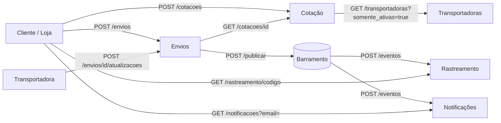

# Documento de Requisitos — Módulo de Logística de Entregas (ERS-LOG-001)

> Modelo **ERL** (Especificação de Requisitos para LLM), versão 2.0 (microsserviços).

| Campo | Valor |
|---|---|
| Versão do documento | 1.0 |
| Data | 2026-10-21 |
| Autores | Pedro Blamires Cordeiro, Adriano Faleiro Gregório, Gabriel Borges, Heitor Felipe Trindade Deodato, Jefferson Felex de Faria, Vinícius Rodrigues Gonçalves Ferreira, Gabriel Rodrigues do Vale |
| Situação | Pronto para geração |

---

## 0. Instruções para quem implementa

Este documento é a única fonte de verdade. Ao implementar:

1. Implemente **todos** os requisitos `RF`, `RN` e `RNF` deste documento, e **somente** eles.
2. Use exatamente os caminhos de arquivo, rotas HTTP, nomes de campos JSON, códigos de status e códigos de erro deste documento. Não renomeie, não traduza, não acrescente campos obrigatórios.
3. Quando mais de um erro se aplicar à mesma requisição, siga a **ordem de validação** de cada requisito.
4. Os **critérios de aceitação** (`CA`) são exemplos obrigatórios: o sistema deve produzir exatamente os resultados descritos.
5. Não invente regras. O que não está descrito aqui está na Seção 1.3 (fora de escopo).
6. Entregue a saída no formato da Seção 13.

---

## 1. Visão geral

### 1.1 Objetivo

Módulo de logística de um marketplace (como Mercado Livre ou Amazon) que entrega produtos na casa do cliente por meio de transportadoras parceiras. O cliente informa o destino e o pacote, recebe uma cotação com o preço e o prazo de cada transportadora e **escolhe a transportadora** que vai levar o pedido. Depois, o envio é acompanhado por rastreamento e o cliente recebe notificações a cada etapa importante.

### 1.2 Escopo: o que está incluído

- Cadastro de transportadoras, com área atendida, tabela de preço, prazo e peso máximo.
- Cotação de frete: cálculo de peso taxado, preço e data prevista de entrega por transportadora.
- Criação do envio com a transportadora escolhida pelo cliente, ciclo de vida do envio e cancelamento.
- Rastreamento público pelo código de rastreio.
- Notificações ao cliente.
- Comunicação entre serviços por HTTP (consultas) e por eventos (mudanças de estado).

### 1.3 Fora de escopo

- Persistência em banco de dados: cada serviço guarda seu estado em memória.
- Autenticação, autorização, HTTPS e interface gráfica.
- Pagamento do frete, frete grátis e cupons.
- Feriados (só sábado e domingo deixam de ser dias úteis).
- CEPs fora das 8 UFs da Tabela 7.1.
- Envio real de e-mail: a notificação é apenas registrada.
- Falhas do barramento de eventos e entrega fora de ordem: o barramento entrega em ordem e de forma síncrona (Seção 6.2).
- Leitura do relógio do sistema: toda data e hora chega no corpo da requisição.
- Edição ou exclusão de transportadoras (só ativar e desativar).

### 1.4 Atores

| Ator | Descrição | Serviços que usa |
|---|---|---|
| Cliente | Comprador que cota o frete, escolhe a transportadora e acompanha a entrega | Cotação, Envios, Rastreamento, Notificações |
| Loja (marketplace) | Sistema da loja que cria o envio quando o pedido é pago | Envios |
| Operador de logística | Funcionário que cadastra e ativa transportadoras | Transportadoras |
| Transportadora | Sistema da transportadora que informa coletas e entregas | Envios (atualizações) |

---

## 2. Glossário

| Termo | Definição |
|---|---|
| Transportadora | Empresa parceira que faz a entrega. Identificada por um `id` de letras maiúsculas, dígitos e `_`. |
| UF atendida | Unidade da federação em que a transportadora coleta e entrega. |
| Pacote | Volume único com peso real em gramas e dimensões em centímetros. |
| Peso cubado | `teto(comprimento × largura × altura ÷ 6)` em gramas (equivale a cm³ ÷ 6000 em kg). |
| Peso taxado | O maior entre o peso real e o peso cubado, em gramas. |
| Kg cobrados | `teto(peso taxado ÷ 1000)`: todo quilo iniciado é cobrado inteiro. |
| Interestadual | Cotação em que a UF de origem é diferente da UF de destino. |
| Dia útil | Segunda a sexta-feira. Feriados não são considerados. |
| Cotação | Resultado de um cálculo de frete, com uma opção por transportadora elegível. Válida por 7 dias corridos. |
| Opção | Par transportadora + preço + prazo dentro de uma cotação. |
| Envio | Remessa de um pedido por uma transportadora escolhida pelo cliente. |
| Código de rastreio | Identificador público do envio, no formato `LG` + 9 dígitos + `BR`. |
| Evento | Mensagem publicada no barramento quando o estado de um envio muda. |
| Barramento | Serviço de infraestrutura, **fornecido pronto**, que repassa eventos aos assinantes (Seção 6.2). |
| Estado terminal | `ENTREGUE`, `CANCELADO` ou `DEVOLVIDO`. Um envio em estado terminal não muda mais. |
| `teto(x)` | Menor inteiro maior ou igual a `x`. |

---

## 3. Arquitetura

### 3.1 Serviços

| Serviço | Responsabilidade | Arquivo | Variável com a URL base |
|---|---|---|---|
| Transportadoras | Cadastro e consulta de transportadoras | `servicos/transportadoras/main.py` | `URL_TRANSPORTADORAS` |
| Cotação | Cálculo de frete e guarda das cotações | `servicos/cotacao/main.py` | `URL_COTACAO` |
| Envios | Criação, ciclo de vida e cancelamento dos envios; publica eventos | `servicos/envios/main.py` | `URL_ENVIOS` |
| Rastreamento | Consome eventos e expõe o rastreamento público | `servicos/rastreamento/main.py` | `URL_RASTREAMENTO` |
| Notificações | Consome eventos e registra as notificações ao cliente | `servicos/notificacoes/main.py` | `URL_NOTIFICACOES` |
| Barramento (fornecido) | Repassa eventos publicados aos assinantes | não deve ser implementado | `URL_BARRAMENTO` |

Cada serviço é um processo separado, com estado próprio em memória. **Um serviço nunca lê nem altera os dados de outro diretamente**: só pelas rotas HTTP e pelos eventos descritos aqui.

### 3.2 Comunicação



| De | Para | Forma | Quando |
|---|---|---|---|
| Cotação | Transportadoras | HTTP síncrono `GET {URL_TRANSPORTADORAS}/transportadoras?somente_ativas=true` | A cada `POST /cotacoes` |
| Envios | Cotação | HTTP síncrono `GET {URL_COTACAO}/cotacoes/{id}` | A cada `POST /envios` |
| Envios | Barramento | HTTP `POST {URL_BARRAMENTO}/publicar` | A cada mudança de estado de um envio |
| Barramento | Rastreamento e Notificações | HTTP `POST {url}/eventos` | Para cada evento publicado |

As URLs base são lidas das variáveis de ambiente da Tabela 3.1, sem barra no final (ex.: `http://127.0.0.1:8102`). O código deve ler a variável **no momento da chamada** (`os.environ[...]`), não fixar um valor.

---

## 4. Restrições técnicas

| ID | Restrição |
|---|---|
| RT-01 | Python 3.10 ou superior. |
| RT-02 | Dependências permitidas: biblioteca padrão, `fastapi`, `pydantic`, `starlette`, `uvicorn` e `httpx`. Nenhuma outra. |
| RT-03 | Um arquivo por serviço, nos caminhos da Tabela 3.1. Cada arquivo expõe uma variável `app` (instância de `FastAPI`) e é executado com `uvicorn servicos.<servico>.main:app`. Um serviço não importa código de outro. |
| RT-04 | Chamadas HTTP de saída usam `httpx` de forma síncrona, com tempo-limite de 10 segundos. |
| RT-05 | Dinheiro em centavos (`int`); peso em gramas (`int`); dimensões em centímetros (`int`); datas no formato `"AAAA-MM-DD"`; data e hora no formato `"AAAA-MM-DDTHH:MM:SS"`, sem fuso horário. |
| RT-06 | Nenhum serviço lê o relógio do computador para regras de negócio. Os identificadores de evento (`uuid4`) são a única fonte de aleatoriedade permitida. |
| RT-07 | O código não deve imprimir nada na saída padrão. |

---

## 5. Convenções gerais da API

Valem para **todas** as rotas de todos os serviços.

### 5.1 Formato

- Corpo de requisição e de resposta em JSON, com os nomes de campo exatamente como neste documento.
- Campos não descritos no corpo da requisição são ignorados.

### 5.2 Erros

Toda resposta de erro tem o corpo:

```json
{"erro": "CODIGO_DO_ERRO", "mensagem": "texto livre em português"}
```

| HTTP | `erro` | Quando |
|---|---|---|
| 422 | `DADOS_INVALIDOS` | Corpo ou parâmetro de consulta ausente, com tipo errado ou fora das restrições. **Inclui os erros de validação automática do FastAPI**, que devem ser convertidos para este formato. |
| 404 | `<RECURSO>_NAO_ENCONTRADO` / `_NAO_ENCONTRADA` | Recurso da rota não existe (o código exato está em cada RF). |
| 409 | conforme o RF | Conflito com o estado atual. |
| 422 | conforme o RF | Regra de negócio violada por um dado bem formado. |
| 503 | `SERVICO_INDISPONIVEL` | Um serviço chamado por HTTP não respondeu ou respondeu com erro 5xx. |

### 5.3 Ordem geral de validação

Em toda rota, a validação do corpo e dos parâmetros (`DADOS_INVALIDOS`) vem **antes** de qualquer outra verificação, inclusive da existência do recurso da rota. Depois disso, vale a ordem de cada RF.

### 5.4 Atomicidade

Uma requisição que termina em erro não altera nenhum estado, não consome identificador e não publica evento.

### 5.5 Identificadores

| Recurso | Formato | Regra |
|---|---|---|
| Cotação | `COT-` + 6 dígitos (`COT-000001`) | Sequencial a partir de 1, por cotação criada com sucesso |
| Envio | `ENV-` + 6 dígitos (`ENV-000001`) | Sequencial a partir de 1, por envio criado com sucesso |
| Código de rastreio | `LG` + 9 dígitos + `BR` (`LG000000001BR`) | Mesmo número sequencial do envio |
| Notificação | `NOT-` + 6 dígitos (`NOT-000001`) | Sequencial a partir de 1, por notificação registrada |
| Evento | `uuid4` em texto | Gerado por quem publica |

### 5.6 Reinício de estado

Todo serviço tem a rota `POST /admin/reset`, que apaga todo o estado em memória daquele serviço (inclusive contadores de identificadores e eventos já processados) e responde **204** sem corpo. Ela existe para os testes automatizados.

---

## 6. Eventos

### 6.1 Envelope

Todo evento tem o formato:

```json
{
  "id": "3f2b8c1e-...",
  "tipo": "envio.criado",
  "ocorrido_em": "2026-03-02T10:00:00",
  "dados": { }
}
```

`ocorrido_em` é a `data_hora` da operação que gerou o evento.

### 6.2 Barramento (fornecido pronto)

O barramento já existe e **não deve ser implementado**. Contrato:

- `POST {URL_BARRAMENTO}/publicar` com o envelope no corpo. O barramento repassa o evento, **em ordem e de forma síncrona**, para `POST {url}/eventos` de cada assinante (Rastreamento e Notificações), e só então responde **202**.
- Todos os assinantes recebem todos os tipos de evento.
- Um serviço que não reconhece o `tipo` de um evento deve ignorá-lo.

### 6.3 Catálogo de eventos (publicados pelo serviço Envios)

| Tipo | Quando | `dados` |
|---|---|---|
| `envio.criado` | Envio criado (RF-E01) | `envio_id`, `codigo_rastreio`, `pedido_id`, `transportadora_id`, `data_prevista_entrega`, `destinatario_email`, `data_hora` |
| `envio.status_atualizado` | Cada novo item no histórico de um envio, exceto o `CRIADO` (RF-E04, RF-E05) | `envio_id`, `codigo_rastreio`, `pedido_id`, `status`, `data_hora`, `local`, `destinatario_email` |

Quando uma única operação gera dois itens no histórico (3ª falha de entrega, RN-12), são publicados dois eventos `envio.status_atualizado`, na ordem dos itens.

### 6.4 Consumo de eventos

Rastreamento e Notificações expõem `POST /eventos`:

- Envelope sem algum dos campos `id`, `tipo`, `ocorrido_em` ou `dados` → **422** `DADOS_INVALIDOS`.
- Evento com `id` já processado → **200** `{"processado": false}`, sem efeito (idempotência).
- Evento de `tipo` desconhecido → **200** `{"processado": false}`, sem efeito. O `id` não é registrado.
- Caso contrário → aplica o efeito do RF e responde **200** `{"processado": true}`.

---

## 7. Regras de negócio

### 7.1 Tabela de CEP por UF

O CEP tem exatamente 8 dígitos (`"01310100"`). A UF é obtida comparando o CEP, como número, com as faixas abaixo (limites incluídos). CEP fora das faixas não é atendido.

| UF | Faixa de CEP |
|---|---|
| SP | 01000000 a 19999999 |
| RJ | 20000000 a 28999999 |
| ES | 29000000 a 29999999 |
| MG | 30000000 a 39999999 |
| BA | 40000000 a 48999999 |
| PR | 80000000 a 87999999 |
| SC | 88000000 a 89999999 |
| RS | 90000000 a 99999999 |

### 7.2 Regras

| ID | Regra |
|---|---|
| RN-01 | Uma transportadora é **elegível** para uma cotação se estiver ativa, atender a UF de origem **e** a UF de destino, e o peso taxado for menor ou igual ao seu `peso_maximo_g`. |
| RN-02 | Peso cubado = `teto(comprimento_cm × largura_cm × altura_cm ÷ 6)` gramas. Peso taxado = maior entre `peso_g` e o peso cubado. |
| RN-03 | Preço base = `tarifa_base_centavos + tarifa_kg_centavos × teto(peso_taxado_g ÷ 1000)`. |
| RN-04 | Se a cotação for interestadual, preço = `teto(preço_base × (100 + adicional_interestadual_pct) ÷ 100)`. Senão, preço = preço base. O arredondamento é sempre para cima, ao centavo. |
| RN-05 | Prazo em dias úteis = `prazo_dias_uteis` da transportadora, mais `dias_adicionais_interestadual` se a cotação for interestadual. |
| RN-06 | Data prevista de entrega = a data da cotação somada ao prazo em dias úteis: avança-se um dia por vez e só contam segunda a sexta. A própria data da cotação nunca conta, mesmo que seja dia útil. Ex.: sexta-feira 2026-03-06 + 1 dia útil = segunda-feira 2026-03-09. |
| RN-07 | As opções de uma cotação são ordenadas por preço crescente; em empate, por prazo crescente; persistindo o empate, por `transportadora_id` em ordem alfabética. |
| RN-08 | Uma cotação vale até `valida_ate` = data da cotação + 7 dias corridos, inclusive. Um envio pode usar a cotação se a **data** da sua `data_hora` for menor ou igual a `valida_ate`. |
| RN-09 | **O cliente escolhe a transportadora**: o envio usa a opção da transportadora escolhida, com o preço e a data prevista congelados na cotação, mesmo que a transportadora tenha sido desativada ou alterada depois. A escolha não precisa ser a mais barata. |
| RN-10 | Um pedido (`pedido_id`) só pode ter um envio que não esteja `CANCELADO`. Depois de cancelado, o pedido pode ganhar um novo envio. |
| RN-11 | Transições de estado permitidas: `CRIADO → COLETADO`, `COLETADO → EM_TRANSITO`, `EM_TRANSITO → EM_TRANSITO` (nova passagem por outra cidade), `EM_TRANSITO → SAIU_PARA_ENTREGA`, `SAIU_PARA_ENTREGA → ENTREGUE`, `SAIU_PARA_ENTREGA → FALHA_ENTREGA`, `FALHA_ENTREGA → SAIU_PARA_ENTREGA`, e `CRIADO → CANCELADO` (só por RF-E05). Qualquer outra é inválida. |
| RN-12 | Cada `FALHA_ENTREGA` aumenta `tentativas_falhas` em 1. Na 3ª falha, depois de registrar `FALHA_ENTREGA` no histórico, o envio passa automaticamente para `DEVOLVIDO`, com um segundo item no histórico de mesma `data_hora` e mesmo `local`. |
| RN-13 | A `data_hora` de uma atualização ou cancelamento deve ser maior ou igual à `data_hora` do último item do histórico. |
| RN-14 | Um envio está **atrasado** numa data `D` se não estiver em estado terminal e `D` for posterior à `data_prevista_entrega`. |
| RN-15 | Só geram notificação os estados `CRIADO`, `SAIU_PARA_ENTREGA`, `ENTREGUE`, `FALHA_ENTREGA`, `DEVOLVIDO` e `CANCELADO`. `COLETADO` e `EM_TRANSITO` não geram notificação. |

---

## 8. Serviços e requisitos funcionais

### 8.0 Cenário base dos critérios de aceitação

Salvo indicação em contrário, os CAs partem de todos os serviços reiniciados e destas transportadoras cadastradas (**cenário S0**):

| Campo | `RAPIDA` | `ECONOMICA` | `EXPRESSA` |
|---|---|---|---|
| `nome` | `"Rápida Log"` | `"Econômica Express"` | `"Expressa Já"` |
| `ufs_atendidas` | `["SP", "RJ", "MG"]` | `["SP", "RJ", "MG", "PR", "SC", "RS"]` | `["SP"]` |
| `tarifa_base_centavos` | 1500 | 900 | 2500 |
| `tarifa_kg_centavos` | 300 | 200 | 100 |
| `adicional_interestadual_pct` | 20 | 10 | 0 |
| `prazo_dias_uteis` | 2 | 5 | 1 |
| `dias_adicionais_interestadual` | 2 | 3 | 0 |
| `peso_maximo_g` | 30000 | 50000 | 10000 |

E destas requisições de cotação de referência (a data 2026-03-02 é uma segunda-feira):

| Nome | Corpo de `POST /cotacoes` |
|---|---|
| **Q-A** (SP→SP) | `{"cep_origem": "01310100", "cep_destino": "04538133", "pacote": {"peso_g": 2000, "comprimento_cm": 30, "largura_cm": 20, "altura_cm": 10}, "data": "2026-03-02"}` |
| **Q-B** (SP→RJ) | `{"cep_origem": "01310100", "cep_destino": "20040002", "pacote": {"peso_g": 1500, "comprimento_cm": 40, "largura_cm": 30, "altura_cm": 20}, "data": "2026-03-02"}` |

E deste corpo de criação de envio (**E-1**), usado depois de Q-A ter gerado `COT-000001`:

```json
{"pedido_id": "PED-1", "cotacao_id": "COT-000001", "transportadora_id": "RAPIDA",
 "destinatario": {"nome": "Ana Souza", "email": "ana@exemplo.com"},
 "data_hora": "2026-03-02T10:00:00"}
```

---

### 8.1 Serviço Transportadoras

**Modelo de dados — Transportadora**

| Campo | Tipo | Restrições | Valor inicial |
|---|---|---|---|
| `id` | string | 2 a 20 caracteres, só `A-Z`, `0-9` e `_` | — |
| `nome` | string | não vazio e não só espaços | — |
| `ufs_atendidas` | lista de string | não vazia; cada item é uma UF da Tabela 7.1; sem repetição | — |
| `tarifa_base_centavos` | int | ≥ 0 | — |
| `tarifa_kg_centavos` | int | ≥ 0 | — |
| `adicional_interestadual_pct` | int | 0 a 100 | — |
| `prazo_dias_uteis` | int | ≥ 1 | — |
| `dias_adicionais_interestadual` | int | ≥ 0 | — |
| `peso_maximo_g` | int | ≥ 1 | — |
| `ativa` | bool | — | `true` |

**Rotas**

| Método e rota | Sucesso | RF |
|---|---|---|
| `POST /transportadoras` | 201, transportadora | RF-T01 |
| `GET /transportadoras?somente_ativas=<bool>` | 200, lista | RF-T02 |
| `GET /transportadoras/{id}` | 200, transportadora | RF-T03 |
| `PATCH /transportadoras/{id}` | 200, transportadora | RF-T04 |

#### RF-T01 — Cadastrar transportadora

- **Descrição:** O sistema deve cadastrar uma transportadora com os campos do modelo de dados, exceto `ativa`, que começa `true`.
- **Corpo:** todos os campos do modelo, exceto `ativa` (se enviado, é ignorado).
- **Resposta:** 201 com a transportadora completa, incluindo `"ativa": true`.

| # | Condição | HTTP | `erro` |
|---|---|---|---|
| 1 | Campo ausente ou fora das restrições do modelo | 422 | `DADOS_INVALIDOS` |
| 2 | Já existe transportadora com o mesmo `id` | 409 | `TRANSPORTADORA_DUPLICADA` |

- **CA-T01-01** — Dado nenhum cadastro, quando `POST /transportadoras` com os dados de `RAPIDA` do S0, então 201 e o corpo é igual aos dados enviados mais `"ativa": true`.
- **CA-T01-02** — Quando `id` é `"rapida"` (minúsculas), então 422 `DADOS_INVALIDOS`.
- **CA-T01-03** — Quando `ufs_atendidas` é `["SP", "AM"]`, então 422 `DADOS_INVALIDOS`.
- **CA-T01-04** — Quando `tarifa_kg_centavos` é `-1`, então 422 `DADOS_INVALIDOS`.
- **CA-T01-05** — Quando o campo `nome` está ausente, então 422 e o corpo da resposta tem exatamente as chaves `erro` (`"DADOS_INVALIDOS"`) e `mensagem` (texto).
- **CA-T01-06** — Dado `RAPIDA` cadastrada, quando `POST` de novo com `id` `RAPIDA`, então 409 `TRANSPORTADORA_DUPLICADA`.

#### RF-T02 — Listar transportadoras

- **Descrição:** O sistema deve listar as transportadoras em ordem alfabética de `id`. Com `somente_ativas=true`, só as ativas. Sem o parâmetro, ou com `false`, todas.
- **Resposta:** 200 com uma lista de transportadoras.

- **CA-T02-01** — Dado S0, quando `GET /transportadoras`, então os `id` são `["ECONOMICA", "EXPRESSA", "RAPIDA"]`.
- **CA-T02-02** — Dado S0 com `EXPRESSA` desativada, quando `GET /transportadoras?somente_ativas=true`, então os `id` são `["ECONOMICA", "RAPIDA"]`; e `GET /transportadoras` continua com 3 itens.

#### RF-T03 — Consultar transportadora

| # | Condição | HTTP | `erro` |
|---|---|---|---|
| 1 | Não existe transportadora com o `id` | 404 | `TRANSPORTADORA_NAO_ENCONTRADA` |

- **CA-T03-01** — Dado S0, quando `GET /transportadoras/RAPIDA`, então 200 com os dados de `RAPIDA` e `"ativa": true`.
- **CA-T03-02** — Quando `GET /transportadoras/XPTO`, então 404 `TRANSPORTADORA_NAO_ENCONTRADA`.

#### RF-T04 — Ativar ou desativar transportadora

- **Corpo:** `{"ativa": <bool>}` (obrigatório).
- **Efeito:** altera só o campo `ativa`.
- **Resposta:** 200 com a transportadora.

| # | Condição | HTTP | `erro` |
|---|---|---|---|
| 1 | Corpo sem `ativa` ou com tipo errado | 422 | `DADOS_INVALIDOS` |
| 2 | Não existe transportadora com o `id` | 404 | `TRANSPORTADORA_NAO_ENCONTRADA` |

- **CA-T04-01** — Dado S0, quando `PATCH /transportadoras/EXPRESSA` com `{"ativa": false}`, então 200 e `"ativa": false`.
- **CA-T04-02** — Quando `PATCH /transportadoras/XPTO` com `{"ativa": false}`, então 404 `TRANSPORTADORA_NAO_ENCONTRADA`.
- **CA-T04-03** — Dado S0, quando `PATCH /transportadoras/RAPIDA` com `{}`, então 422 `DADOS_INVALIDOS`.

---

### 8.2 Serviço Cotação

**Corpo de `POST /cotacoes`**

| Campo | Tipo | Restrições |
|---|---|---|
| `cep_origem` | string | exatamente 8 dígitos |
| `cep_destino` | string | exatamente 8 dígitos |
| `pacote.peso_g` | int | 1 a 100000 |
| `pacote.comprimento_cm`, `pacote.largura_cm`, `pacote.altura_cm` | int | 1 a 200 cada |
| `data` | string de data | data válida `AAAA-MM-DD` |

**Modelo — Cotação (resposta)**

| Campo | Tipo | Valor |
|---|---|---|
| `id` | string | `COT-000001`, ... |
| `cep_origem`, `cep_destino` | string | como recebidos |
| `uf_origem`, `uf_destino` | string | pela Tabela 7.1 |
| `peso_taxado_g` | int | RN-02 |
| `data` | string | como recebida |
| `valida_ate` | string | RN-08 |
| `opcoes` | lista | uma por transportadora elegível (RN-01), na ordem da RN-07 |
| `opcoes[].transportadora_id` | string | — |
| `opcoes[].nome` | string | nome da transportadora |
| `opcoes[].preco_centavos` | int | RN-03 e RN-04 |
| `opcoes[].prazo_dias_uteis` | int | RN-05 |
| `opcoes[].data_prevista_entrega` | string | RN-06 |

**Rotas**

| Método e rota | Sucesso | RF |
|---|---|---|
| `POST /cotacoes` | 201, cotação | RF-C01 |
| `GET /cotacoes/{id}` | 200, cotação | RF-C02 |

#### RF-C01 — Cotar frete

- **Descrição:** O sistema deve calcular, para cada transportadora elegível, o preço e a data prevista de entrega do pacote, guardar a cotação e devolvê-la.
- **Dependência:** obtém as transportadoras com `GET {URL_TRANSPORTADORAS}/transportadoras?somente_ativas=true`.
- **Efeito:** guarda a cotação com o próximo `id`.
- **Resposta:** 201 com a cotação. Se nenhuma transportadora for elegível, a cotação é criada normalmente com `"opcoes": []`.

| # | Condição | HTTP | `erro` |
|---|---|---|---|
| 1 | Corpo fora das restrições | 422 | `DADOS_INVALIDOS` |
| 2 | CEP de origem ou de destino fora da Tabela 7.1 | 422 | `CEP_FORA_DA_AREA` |
| 3 | Serviço Transportadoras não responde ou responde 5xx | 503 | `SERVICO_INDISPONIVEL` |

- **CA-C01-01** — Dado S0, quando Q-A, então 201 com `"id": "COT-000001"`, `"uf_origem": "SP"`, `"uf_destino": "SP"`, `"peso_taxado_g": 2000`, `"valida_ate": "2026-03-09"` e `opcoes` igual a, nesta ordem:
  `{"transportadora_id": "ECONOMICA", "nome": "Econômica Express", "preco_centavos": 1300, "prazo_dias_uteis": 5, "data_prevista_entrega": "2026-03-09"}`,
  `{"transportadora_id": "RAPIDA", "nome": "Rápida Log", "preco_centavos": 2100, "prazo_dias_uteis": 2, "data_prevista_entrega": "2026-03-04"}`,
  `{"transportadora_id": "EXPRESSA", "nome": "Expressa Já", "preco_centavos": 2700, "prazo_dias_uteis": 1, "data_prevista_entrega": "2026-03-03"}`.
- **CA-C01-02** — Dado S0, quando Q-B (interestadual; peso cubado 4000 g, 4 kg cobrados), então `"uf_destino": "RJ"`, `"peso_taxado_g": 4000` e `opcoes` igual a:
  `{"transportadora_id": "ECONOMICA", "nome": "Econômica Express", "preco_centavos": 1870, "prazo_dias_uteis": 8, "data_prevista_entrega": "2026-03-12"}`,
  `{"transportadora_id": "RAPIDA", "nome": "Rápida Log", "preco_centavos": 3240, "prazo_dias_uteis": 4, "data_prevista_entrega": "2026-03-06"}`.
  `EXPRESSA` não aparece porque não atende RJ.
- **CA-C01-03** — Dado S0, quando Q-A com `pacote` = `{"peso_g": 100, "comprimento_cm": 10, "largura_cm": 10, "altura_cm": 11}`, então `"peso_taxado_g": 184` (1100 ÷ 6 = 183,33, arredondado para cima).
- **CA-C01-04** — Dado só a transportadora `ARRED` cadastrada (`ufs_atendidas` `["SP", "RJ"]`, `tarifa_base_centavos` 1001, `tarifa_kg_centavos` 0, `adicional_interestadual_pct` 10, `prazo_dias_uteis` 1, `dias_adicionais_interestadual` 0, `peso_maximo_g` 50000), quando Q-B, então a única opção tem `"preco_centavos": 1102` (1001 × 1,10 = 1101,1, arredondado para cima).
- **CA-C01-05** — Dado S0, quando Q-A com `pacote` = `{"peso_g": 10000, "comprimento_cm": 10, "largura_cm": 10, "altura_cm": 10}`, então `EXPRESSA` aparece nas opções; e com `"peso_g": 10001`, `EXPRESSA` não aparece.
- **CA-C01-06** — Dado S0 com `RAPIDA` desativada, quando Q-A, então os `transportadora_id` das opções são `["ECONOMICA", "EXPRESSA"]`.
- **CA-C01-07** — Dado S0, quando Q-A com `"data": "2026-03-06"` (sexta-feira), então a opção `EXPRESSA` tem `"data_prevista_entrega": "2026-03-09"`; e quando Q-A com `"data": "2026-03-07"` (sábado), a opção `EXPRESSA` também tem `"2026-03-09"`.
- **CA-C01-08** — Dado só as transportadoras `BETA` e `ALFA` cadastradas, nesta ordem, com dados idênticos (`ufs_atendidas` `["SP"]`, `tarifa_base_centavos` 1000, `tarifa_kg_centavos` 100, `adicional_interestadual_pct` 0, `prazo_dias_uteis` 3, `dias_adicionais_interestadual` 0, `peso_maximo_g` 30000), quando Q-A, então os `transportadora_id` das opções são `["ALFA", "BETA"]`.
- **CA-C01-09** — Quando Q-A com `"cep_origem": "0131010"` (7 dígitos), então 422 `DADOS_INVALIDOS`.
- **CA-C01-10** — Dado S0, quando Q-A com `"cep_destino": "69000000"`, então 422 `CEP_FORA_DA_AREA`.
- **CA-C01-11** — Dado S0, quando Q-A com `"cep_destino": "40020000"` (BA, que nenhuma transportadora atende), então 201 com `"opcoes": []`.
- **CA-C01-12** — Dado S0, quando Q-A e depois Q-B, então os `id` são `"COT-000001"` e `"COT-000002"`; e uma Q-A com `"altura_cm": 0` entre as duas responde 422 `DADOS_INVALIDOS` e não consome `id`.

#### RF-C02 — Consultar cotação

| # | Condição | HTTP | `erro` |
|---|---|---|---|
| 1 | Não existe cotação com o `id` | 404 | `COTACAO_NAO_ENCONTRADA` |

- **CA-C02-01** — Dado S0 e Q-A criada, quando `GET /cotacoes/COT-000001`, então 200 com o mesmo corpo devolvido na criação.
- **CA-C02-02** — Quando `GET /cotacoes/COT-999999`, então 404 `COTACAO_NAO_ENCONTRADA`.

---

### 8.3 Serviço Envios

**Corpo de `POST /envios`**

| Campo | Tipo | Restrições |
|---|---|---|
| `pedido_id` | string | não vazio e não só espaços |
| `cotacao_id` | string | não vazio |
| `transportadora_id` | string | não vazio |
| `destinatario.nome` | string | não vazio e não só espaços |
| `destinatario.email` | string | casa com a expressão `^[^@\s]+@[^@\s]+\.[^@\s]+$` |
| `data_hora` | string | data e hora válidas `AAAA-MM-DDTHH:MM:SS` |

**Modelo — Envio (resposta)**

| Campo | Tipo | Valor inicial |
|---|---|---|
| `id` | string | `ENV-000001`, ... |
| `codigo_rastreio` | string | `LG000000001BR`, ... |
| `pedido_id`, `cotacao_id`, `transportadora_id` | string | como recebidos |
| `preco_centavos` | int | da opção escolhida na cotação |
| `data_prevista_entrega` | string | da opção escolhida na cotação |
| `destinatario` | objeto | `{"nome", "email"}` como recebidos |
| `status` | string | `"CRIADO"` |
| `tentativas_falhas` | int | `0` |
| `historico` | lista | `[{"status": "CRIADO", "data_hora": <data_hora>, "local": null}]` |

Cada item do `historico` tem `status`, `data_hora` e `local` (string ou `null`), em ordem de registro.

**Rotas**

| Método e rota | Sucesso | RF |
|---|---|---|
| `POST /envios` | 201, envio | RF-E01 |
| `GET /envios/{id}` | 200, envio | RF-E02 |
| `GET /envios?pedido_id=<id>` | 200, lista | RF-E03 |
| `POST /envios/{id}/atualizacoes` | 200, envio | RF-E04 |
| `POST /envios/{id}/cancelar` | 200, envio | RF-E05 |

#### RF-E01 — Criar envio com a transportadora escolhida pelo cliente

- **Descrição:** O sistema deve criar o envio de um pedido usando a opção da transportadora escolhida pelo cliente numa cotação válida (RN-08, RN-09, RN-10).
- **Dependência:** obtém a cotação com `GET {URL_COTACAO}/cotacoes/{cotacao_id}`.
- **Efeito:** guarda o envio com os próximos `id` e `codigo_rastreio` e publica `envio.criado`.
- **Resposta:** 201 com o envio.

| # | Condição | HTTP | `erro` |
|---|---|---|---|
| 1 | Corpo fora das restrições | 422 | `DADOS_INVALIDOS` |
| 2 | O `pedido_id` já tem um envio que não está `CANCELADO` | 409 | `ENVIO_DUPLICADO` |
| 3 | O serviço Cotação responde 404 para a cotação | 422 | `COTACAO_NAO_ENCONTRADA` |
| 4 | O serviço Cotação não responde ou responde 5xx | 503 | `SERVICO_INDISPONIVEL` |
| 5 | A data de `data_hora` é posterior a `valida_ate` | 422 | `COTACAO_EXPIRADA` |
| 6 | `transportadora_id` não está entre as opções da cotação | 422 | `TRANSPORTADORA_NAO_OFERECIDA` |

Os CAs abaixo partem de S0 com Q-A criada (`COT-000001`).

- **CA-E01-01** — Quando `POST /envios` com E-1, então 201 com: `"id": "ENV-000001"`, `"codigo_rastreio": "LG000000001BR"`, `"pedido_id": "PED-1"`, `"cotacao_id": "COT-000001"`, `"transportadora_id": "RAPIDA"`, `"preco_centavos": 2100`, `"data_prevista_entrega": "2026-03-04"`, `"destinatario": {"nome": "Ana Souza", "email": "ana@exemplo.com"}`, `"status": "CRIADO"`, `"tentativas_falhas": 0` e `"historico": [{"status": "CRIADO", "data_hora": "2026-03-02T10:00:00", "local": null}]`.
- **CA-E01-02** — Quando E-1 com `"transportadora_id": "EXPRESSA"` (a mais cara), então 201 com `"preco_centavos": 2700` e `"data_prevista_entrega": "2026-03-03"`: vale a escolha do cliente.
- **CA-E01-03** — Dado também Q-B criada (`COT-000002`), quando E-1 com `"cotacao_id": "COT-000002"` e `"transportadora_id": "EXPRESSA"`, então 422 `TRANSPORTADORA_NAO_OFERECIDA`.
- **CA-E01-04** — Quando E-1 com `"data_hora": "2026-03-10T00:00:00"`, então 422 `COTACAO_EXPIRADA`; e com `"data_hora": "2026-03-09T23:59:59"`, então 201.
- **CA-E01-05** — Quando E-1 com `"cotacao_id": "COT-999999"`, então 422 `COTACAO_NAO_ENCONTRADA`.
- **CA-E01-06** — Dado o envio de E-1 criado, quando E-1 de novo, então 409 `ENVIO_DUPLICADO`.
- **CA-E01-07** — Dado o envio de E-1 criado, quando E-1 de novo com `"cotacao_id": "COT-999999"`, então 409 `ENVIO_DUPLICADO` (o pedido duplicado é verificado antes da cotação).
- **CA-E01-08** — Dado `RAPIDA` desativada depois de Q-A, quando E-1, então 201 com `"preco_centavos": 2100`.
- **CA-E01-09** — Quando E-1 com `"email": "ana.exemplo.com"`, então 422 `DADOS_INVALIDOS`.
- **CA-E01-10** — Quando E-1, então o barramento recebe um evento com `"tipo": "envio.criado"`, `"ocorrido_em": "2026-03-02T10:00:00"`, `id` em texto, e `dados` igual a `{"envio_id": "ENV-000001", "codigo_rastreio": "LG000000001BR", "pedido_id": "PED-1", "transportadora_id": "RAPIDA", "data_prevista_entrega": "2026-03-04", "destinatario_email": "ana@exemplo.com", "data_hora": "2026-03-02T10:00:00"}`.

#### RF-E02 — Consultar envio

| # | Condição | HTTP | `erro` |
|---|---|---|---|
| 1 | Não existe envio com o `id` | 404 | `ENVIO_NAO_ENCONTRADO` |

- **CA-E02-01** — Dado o envio de E-1 criado, quando `GET /envios/ENV-000001`, então 200 com o mesmo corpo da criação.
- **CA-E02-02** — Quando `GET /envios/ENV-999999`, então 404 `ENVIO_NAO_ENCONTRADO`.

#### RF-E03 — Listar envios de um pedido

- **Descrição:** O sistema deve listar os envios do `pedido_id` informado, em ordem de `id`. Pedido sem envio → lista vazia.
- **Parâmetro:** `pedido_id` é obrigatório; ausente → 422 `DADOS_INVALIDOS`.

- **CA-E03-01** — Dado o envio de E-1 criado, cancelado (RF-E05) e um novo E-1 criado, quando `GET /envios?pedido_id=PED-1`, então 200 com dois envios: `ENV-000001` com `"status": "CANCELADO"` e `ENV-000002` com `"status": "CRIADO"`.
- **CA-E03-02** — Quando `GET /envios?pedido_id=PED-9`, então 200 com `[]`.

#### RF-E04 — Registrar atualização da transportadora

- **Descrição:** O sistema deve registrar uma nova etapa informada pela transportadora, respeitando as transições da RN-11, a RN-12 e a RN-13.
- **Corpo:** `{"status": <string>, "data_hora": <string>, "local": <string>}`. `status` só pode ser `COLETADO`, `EM_TRANSITO`, `SAIU_PARA_ENTREGA`, `ENTREGUE` ou `FALHA_ENTREGA`. `local` é um texto não vazio (ex.: `"Curitiba/PR"`).
- **Efeito:** acrescenta o item ao `historico`, atualiza `status` (e `tentativas_falhas`, se for falha) e publica um `envio.status_atualizado` por item acrescentado.
- **Resposta:** 200 com o envio.

| # | Condição | HTTP | `erro` |
|---|---|---|---|
| 1 | Corpo fora das restrições (inclusive `status` fora da lista) | 422 | `DADOS_INVALIDOS` |
| 2 | Não existe envio com o `id` | 404 | `ENVIO_NAO_ENCONTRADO` |
| 3 | Transição não permitida pela RN-11 (inclusive a partir de estado terminal) | 409 | `TRANSICAO_INVALIDA` |
| 4 | `data_hora` anterior à do último item do histórico | 422 | `DATA_HORA_INVALIDA` |

Os CAs abaixo partem de S0, Q-A e o envio de E-1 criado (`ENV-000001`). "Atualizar X em H" significa `POST /envios/ENV-000001/atualizacoes` com `{"status": X, "data_hora": H, "local": "São Paulo/SP"}`, salvo indicação.

- **CA-E04-01** — Quando atualizar `COLETADO` em `2026-03-02T15:00:00`, `EM_TRANSITO` em `2026-03-03T08:00:00`, `SAIU_PARA_ENTREGA` em `2026-03-04T07:00:00` e `ENTREGUE` em `2026-03-04T14:00:00`, então todas respondem 200, o `status` final é `"ENTREGUE"` e o `historico` tem 5 itens, com os status `CRIADO`, `COLETADO`, `EM_TRANSITO`, `SAIU_PARA_ENTREGA`, `ENTREGUE`, nessa ordem.
- **CA-E04-02** — Quando atualizar `COLETADO` em `2026-03-02T15:00:00`, `EM_TRANSITO` em `2026-03-03T08:00:00` com local `"Campinas/SP"` e `EM_TRANSITO` em `2026-03-03T20:00:00` com local `"Jundiaí/SP"`, então todas respondem 200 e os dois últimos itens do `historico` têm os locais `"Campinas/SP"` e `"Jundiaí/SP"`.
- **CA-E04-03** — Quando atualizar `ENTREGUE` em `2026-03-02T15:00:00`, então 409 `TRANSICAO_INVALIDA` e o envio continua `"CRIADO"` com 1 item no histórico.
- **CA-E04-04** — Quando atualizar `CANCELADO` em `2026-03-02T15:00:00`, então 422 `DADOS_INVALIDOS`.
- **CA-E04-05** — Quando atualizar `COLETADO` em `2026-03-02T09:00:00` (antes da criação), então 422 `DATA_HORA_INVALIDA`.
- **CA-E04-06** — Quando atualizar `COLETADO` (`2026-03-02T15:00:00`), `EM_TRANSITO` (`2026-03-03T08:00:00`), `SAIU_PARA_ENTREGA` (`2026-03-04T07:00:00`), `FALHA_ENTREGA` (`2026-03-04T12:00:00`), `SAIU_PARA_ENTREGA` (`2026-03-05T07:00:00`) e `ENTREGUE` (`2026-03-05T11:00:00`), então o `status` final é `"ENTREGUE"` e `"tentativas_falhas": 1`.
- **CA-E04-07** — Quando atualizar `COLETADO` (`2026-03-02T15:00:00`), `EM_TRANSITO` (`2026-03-03T08:00:00`) e depois três ciclos de `SAIU_PARA_ENTREGA` + `FALHA_ENTREGA`, nos dias 4, 5 e 6 de março às 07:00 e 12:00, então a última resposta tem `"status": "DEVOLVIDO"`, `"tentativas_falhas": 3`, e os dois últimos itens do histórico são `{"status": "FALHA_ENTREGA", "data_hora": "2026-03-06T12:00:00", "local": "São Paulo/SP"}` e `{"status": "DEVOLVIDO", "data_hora": "2026-03-06T12:00:00", "local": "São Paulo/SP"}`.
- **CA-E04-08** — Dado o envio entregue como no CA-E04-01, quando atualizar `EM_TRANSITO` em `2026-03-05T08:00:00`, então 409 `TRANSICAO_INVALIDA`.
- **CA-E04-09** — Quando `POST /envios/ENV-999999/atualizacoes` com corpo válido, então 404 `ENVIO_NAO_ENCONTRADO`.
- **CA-E04-10** — Quando atualizar `COLETADO` com `"local": ""`, então 422 `DADOS_INVALIDOS`.
- **CA-E04-11** — Quando atualizar `COLETADO` em `2026-03-02T15:00:00`, então o barramento recebe um `envio.status_atualizado` com `"ocorrido_em": "2026-03-02T15:00:00"` e `dados` igual a `{"envio_id": "ENV-000001", "codigo_rastreio": "LG000000001BR", "pedido_id": "PED-1", "status": "COLETADO", "data_hora": "2026-03-02T15:00:00", "local": "São Paulo/SP", "destinatario_email": "ana@exemplo.com"}`.
- **CA-E04-12** — Na situação do CA-E04-07, os dois últimos eventos recebidos pelo barramento são `envio.status_atualizado` com `status` `"FALHA_ENTREGA"` e `"DEVOLVIDO"`, nessa ordem.

#### RF-E05 — Cancelar envio

- **Descrição:** O sistema deve cancelar um envio que ainda não foi coletado.
- **Corpo:** `{"data_hora": <string>}`.
- **Efeito:** `status` passa a `"CANCELADO"`, acrescenta `{"status": "CANCELADO", "data_hora": <data_hora>, "local": null}` ao histórico e publica `envio.status_atualizado` com `"local": null`.
- **Resposta:** 200 com o envio.

| # | Condição | HTTP | `erro` |
|---|---|---|---|
| 1 | Corpo fora das restrições | 422 | `DADOS_INVALIDOS` |
| 2 | Não existe envio com o `id` | 404 | `ENVIO_NAO_ENCONTRADO` |
| 3 | O envio não está `CRIADO` | 409 | `TRANSICAO_INVALIDA` |
| 4 | `data_hora` anterior à do último item do histórico | 422 | `DATA_HORA_INVALIDA` |

- **CA-E05-01** — Dado o envio de E-1 criado, quando `POST /envios/ENV-000001/cancelar` com `{"data_hora": "2026-03-02T11:00:00"}`, então 200 com `"status": "CANCELADO"` e o último item do histórico `{"status": "CANCELADO", "data_hora": "2026-03-02T11:00:00", "local": null}`; e o barramento recebe um `envio.status_atualizado` com `"status": "CANCELADO"` e `"local": null`.
- **CA-E05-02** — Dado o envio de E-1 atualizado para `COLETADO` em `2026-03-02T15:00:00`, quando cancelar em `2026-03-02T16:00:00`, então 409 `TRANSICAO_INVALIDA`.
- **CA-E05-03** — Quando `POST /envios/ENV-999999/cancelar` com corpo válido, então 404 `ENVIO_NAO_ENCONTRADO`.

---

### 8.4 Serviço Rastreamento

**Modelo — Rastreamento (resposta)**

| Campo | Tipo | Valor |
|---|---|---|
| `codigo_rastreio` | string | do evento |
| `envio_id` | string | do evento |
| `pedido_id` | string | do evento |
| `transportadora_id` | string | de `envio.criado` |
| `data_prevista_entrega` | string | de `envio.criado` |
| `status` | string | status do último item do histórico |
| `entregue` | bool | `status == "ENTREGUE"` |
| `atrasado` | bool | RN-14 na data do parâmetro `data`; `false` se `data` não for informada |
| `historico` | lista | `{"status", "data_hora", "local"}`, na ordem de recebimento dos eventos |

**Rotas**

| Método e rota | Sucesso | RF |
|---|---|---|
| `POST /eventos` | 200 | RF-R01 |
| `GET /rastreamento/{codigo_rastreio}?data=<AAAA-MM-DD>` | 200, rastreamento | RF-R02 |

#### RF-R01 — Consumir eventos

- **Descrição:** O sistema deve manter o rastreamento de cada envio a partir dos eventos, conforme a Seção 6.4.
- **Efeito de `envio.criado`:** cria o rastreamento com `historico` = `[{"status": "CRIADO", "data_hora": <data_hora>, "local": null}]`.
- **Efeito de `envio.status_atualizado`:** acrescenta `{"status", "data_hora", "local"}` ao histórico do `codigo_rastreio`. Se o código não existir, o evento é ignorado, responde `{"processado": false}` e o `id` não é registrado.

- **CA-R01-01** — Quando o mesmo envelope `envio.criado` (dados do CA-E01-10, `id` `"evt-1"`) é enviado duas vezes direto para `POST /eventos` do Rastreamento, então as respostas são 200 `{"processado": true}` e 200 `{"processado": false}`, e o rastreamento de `LG000000001BR` tem 1 item no histórico.
- **CA-R01-02** — Quando um envelope com `"tipo": "pedido.pago"` é enviado, então 200 `{"processado": false}`.
- **CA-R01-03** — Quando um envelope sem o campo `dados` é enviado, então 422 `DADOS_INVALIDOS`.

#### RF-R02 — Consultar rastreamento

| # | Condição | HTTP | `erro` |
|---|---|---|---|
| 1 | `data` informada em formato inválido | 422 | `DADOS_INVALIDOS` |
| 2 | Não existe rastreamento com o código | 404 | `RASTREIO_NAO_ENCONTRADO` |

Os CAs abaixo usam o fluxo completo: S0, Q-A, E-1 e as atualizações pelo serviço Envios.

- **CA-R02-01** — Dado o envio de E-1 criado, quando `GET /rastreamento/LG000000001BR`, então 200 com `"codigo_rastreio": "LG000000001BR"`, `"envio_id": "ENV-000001"`, `"pedido_id": "PED-1"`, `"transportadora_id": "RAPIDA"`, `"data_prevista_entrega": "2026-03-04"`, `"status": "CRIADO"`, `"entregue": false`, `"atrasado": false` e `"historico": [{"status": "CRIADO", "data_hora": "2026-03-02T10:00:00", "local": null}]`.
- **CA-R02-02** — Dado o envio entregue como no CA-E04-01, quando `GET /rastreamento/LG000000001BR`, então `"status": "ENTREGUE"`, `"entregue": true` e o histórico tem os 5 status do CA-E04-01.
- **CA-R02-03** — Dado o envio em `EM_TRANSITO` (atualizado para `COLETADO` em `2026-03-02T15:00:00` e `EM_TRANSITO` em `2026-03-03T08:00:00`), quando `GET /rastreamento/LG000000001BR?data=2026-03-05`, então `"atrasado": true`; e com `?data=2026-03-04`, `"atrasado": false`.
- **CA-R02-04** — Dado o envio entregue como no CA-E04-01, quando `GET /rastreamento/LG000000001BR?data=2026-03-20`, então `"atrasado": false`.
- **CA-R02-05** — Quando `GET /rastreamento/LG999999999BR`, então 404 `RASTREIO_NAO_ENCONTRADO`.

---

### 8.5 Serviço Notificações

**Modelo — Notificação**

| Campo | Tipo | Valor |
|---|---|---|
| `id` | string | `NOT-000001`, ... |
| `email` | string | `destinatario_email` do evento |
| `pedido_id` | string | do evento |
| `codigo_rastreio` | string | do evento |
| `tipo` | string | o status que gerou a notificação (`CRIADO` para `envio.criado`) |
| `mensagem` | string | Tabela 8.5 |
| `criada_em` | string | `ocorrido_em` do evento |

**Tabela 8.5 — Mensagens** (`{pedido_id}` e `{codigo_rastreio}` são substituídos pelos valores do evento)

| `tipo` | `mensagem` |
|---|---|
| `CRIADO` | `Pedido {pedido_id}: envio criado. Rastreio: {codigo_rastreio}.` |
| `SAIU_PARA_ENTREGA` | `Pedido {pedido_id}: saiu para entrega.` |
| `ENTREGUE` | `Pedido {pedido_id}: entregue.` |
| `FALHA_ENTREGA` | `Pedido {pedido_id}: tentativa de entrega sem sucesso.` |
| `DEVOLVIDO` | `Pedido {pedido_id}: devolvido ao remetente.` |
| `CANCELADO` | `Pedido {pedido_id}: envio cancelado.` |

**Rotas**

| Método e rota | Sucesso | RF |
|---|---|---|
| `POST /eventos` | 200 | RF-N01 |
| `GET /notificacoes?email=<email>` | 200, lista | RF-N02 |

#### RF-N01 — Consumir eventos

- **Descrição:** O sistema deve registrar uma notificação para cada evento cujo status esteja na RN-15, conforme a Seção 6.4.
- **Efeito:** `envio.criado` gera uma notificação de `tipo` `CRIADO`. `envio.status_atualizado` gera uma notificação se o `status` estiver na RN-15. Um evento válido e novo que não gera notificação (ex.: `COLETADO`) ainda responde `{"processado": true}` e tem o `id` registrado.

Os CAs abaixo usam o fluxo completo: S0, Q-A, E-1 e as atualizações pelo serviço Envios.

- **CA-N01-01** — Dado o envio de E-1 criado, quando `GET /notificacoes?email=ana@exemplo.com`, então 200 com uma notificação: `{"id": "NOT-000001", "email": "ana@exemplo.com", "pedido_id": "PED-1", "codigo_rastreio": "LG000000001BR", "tipo": "CRIADO", "mensagem": "Pedido PED-1: envio criado. Rastreio: LG000000001BR.", "criada_em": "2026-03-02T10:00:00"}`.
- **CA-N01-02** — Dado o envio entregue como no CA-E04-01, quando listar as notificações de `ana@exemplo.com`, então os `tipo` são `["CRIADO", "SAIU_PARA_ENTREGA", "ENTREGUE"]` e as mensagens dos dois últimos são `"Pedido PED-1: saiu para entrega."` e `"Pedido PED-1: entregue."`.
- **CA-N01-03** — Dado o envio devolvido como no CA-E04-07, quando listar as notificações, então os `tipo` são `["CRIADO", "SAIU_PARA_ENTREGA", "FALHA_ENTREGA", "SAIU_PARA_ENTREGA", "FALHA_ENTREGA", "SAIU_PARA_ENTREGA", "FALHA_ENTREGA", "DEVOLVIDO"]` e a última mensagem é `"Pedido PED-1: devolvido ao remetente."`.
- **CA-N01-04** — Dado o envio cancelado como no CA-E05-01, quando listar as notificações, então os `tipo` são `["CRIADO", "CANCELADO"]` e a última mensagem é `"Pedido PED-1: envio cancelado."`.
- **CA-N01-05** — Quando o mesmo envelope `envio.criado` (`id` `"evt-1"`, dados do CA-E01-10) é enviado duas vezes direto para `POST /eventos` das Notificações, então as respostas são `{"processado": true}` e `{"processado": false}` e há uma única notificação.

#### RF-N02 — Listar notificações de um cliente

- **Descrição:** O sistema deve listar as notificações do `email` informado, em ordem de `id`.

| # | Condição | HTTP | `erro` |
|---|---|---|---|
| 1 | Parâmetro `email` ausente | 422 | `DADOS_INVALIDOS` |

- **CA-N02-01** — Quando `GET /notificacoes` sem parâmetro, então 422 `DADOS_INVALIDOS`.
- **CA-N02-02** — Dado o envio de E-1 criado, quando `GET /notificacoes?email=bruno@exemplo.com`, então 200 com `[]`.

---

### 8.6 Requisito transversal

#### RF-X01 — Reiniciar estado

- **Descrição:** Todo serviço deve atender `POST /admin/reset` conforme a Seção 5.6.

- **CA-X01-01** — Dado o envio de E-1 criado, quando `POST /admin/reset` nos cinco serviços, recadastrar S0, refazer Q-A e E-1, então os identificadores voltam a ser `COT-000001`, `ENV-000001`, `LG000000001BR` e `NOT-000001`, e o rastreamento tem 1 item no histórico.

---

## 9. Requisitos não funcionais

| ID | Requisito | Métrica / limite | Como verificar |
|---|---|---|---|
| RNF-01 | Dependências | Só as da RT-02 | Inspeção automática dos `import` |
| RNF-02 | Formato de erro | Toda resposta 4xx tem só as chaves `erro` e `mensagem`, ambas texto | Teste automático |
| RNF-03 | Configuração por ambiente | O sistema funciona com as URLs das variáveis de ambiente, em portas quaisquer | Os testes sobem os serviços em portas não padrão |
| RNF-04 | Desempenho | 100 cotações Q-A seguidas em menos de 15 segundos | Teste automático cronometrado |
| RNF-05 | Silêncio | Nenhum serviço escreve na saída padrão durante o cenário integrado (os processos rodam com `uvicorn --no-access-log`, de modo que só o código do serviço poderia escrever) | Teste automático |

- **CA-RNF01-01** — Todo módulo importado pelos cinco arquivos pertence à biblioteca padrão ou é `fastapi`, `pydantic`, `starlette`, `uvicorn` ou `httpx`.
- **CA-RNF02-01** — As respostas de erro do CA-T03-02 (404), do CA-C01-09 (422 de validação automática) e do CA-E04-03 (409) têm exatamente as chaves `erro` e `mensagem`, com valores texto.
- **CA-RNF04-01** — Dado S0, 100 requisições Q-A seguidas terminam em menos de 15 segundos, e a última devolve `"id": "COT-000100"`.
- **CA-RNF05-01** — Durante o cenário integrado da Seção 10, a saída padrão dos cinco processos fica vazia.

---

## 10. Cenário integrado

| Passo | Ator | Requisição | Resultado esperado |
|---|---|---|---|
| 1 | Operador | Cadastra S0 | 201 para as três |
| 2 | Cliente | Q-B (SP→RJ) | 201, `COT-000001`; opções `ECONOMICA` (1870, 2026-03-12) e `RAPIDA` (3240, 2026-03-06) |
| 3 | Loja | `POST /envios` com `pedido_id` `"PED-7"`, `COT-000001`, `transportadora_id` `"RAPIDA"`, destinatário Bruno (`bruno@exemplo.com`), `data_hora` `"2026-03-02T09:30:00"` | 201, `ENV-000001`, `LG000000001BR`, `preco_centavos` 3240 |
| 4 | Transportadora | `COLETADO` em `2026-03-02T17:00:00`, local `"São Paulo/SP"` | 200 |
| 5 | Transportadora | `EM_TRANSITO` em `2026-03-03T09:00:00`, local `"Resende/RJ"` | 200 |
| 6 | Transportadora | `SAIU_PARA_ENTREGA` em `2026-03-05T07:00:00`, local `"Rio de Janeiro/RJ"` | 200 |
| 7 | Transportadora | `ENTREGUE` em `2026-03-05T15:00:00`, local `"Rio de Janeiro/RJ"` | 200, `"status": "ENTREGUE"` |
| 8 | Cliente | `GET /rastreamento/LG000000001BR?data=2026-03-05` | `"entregue": true`, `"atrasado": false`, 5 itens no histórico |
| 9 | Cliente | `GET /notificacoes?email=bruno@exemplo.com` | `tipo` `["CRIADO", "SAIU_PARA_ENTREGA", "ENTREGUE"]` |

- **CA-INT-01** — O cenário integrado acima produz exatamente os resultados da tabela.

---

## 11. Matriz de rastreabilidade

| Requisito | Regras | Rota | Critérios de aceitação |
|---|---|---|---|
| RF-T01 | — | `POST /transportadoras` | CA-T01-01 a 06 |
| RF-T02 | — | `GET /transportadoras` | CA-T02-01 a 02 |
| RF-T03 | — | `GET /transportadoras/{id}` | CA-T03-01 a 02 |
| RF-T04 | RN-01 | `PATCH /transportadoras/{id}` | CA-T04-01 a 03 |
| RF-C01 | RN-01 a RN-08 | `POST /cotacoes` | CA-C01-01 a 12 |
| RF-C02 | — | `GET /cotacoes/{id}` | CA-C02-01 a 02 |
| RF-E01 | RN-08, RN-09, RN-10 | `POST /envios` | CA-E01-01 a 10 |
| RF-E02 | — | `GET /envios/{id}` | CA-E02-01 a 02 |
| RF-E03 | RN-10 | `GET /envios?pedido_id=` | CA-E03-01 a 02 |
| RF-E04 | RN-11, RN-12, RN-13 | `POST /envios/{id}/atualizacoes` | CA-E04-01 a 12 |
| RF-E05 | RN-11, RN-13 | `POST /envios/{id}/cancelar` | CA-E05-01 a 03 |
| RF-R01 | — | `POST /eventos` (Rastreamento) | CA-R01-01 a 03 |
| RF-R02 | RN-14 | `GET /rastreamento/{codigo}` | CA-R02-01 a 05 |
| RF-N01 | RN-15 | `POST /eventos` (Notificações) | CA-N01-01 a 05 |
| RF-N02 | — | `GET /notificacoes` | CA-N02-01 a 02 |
| RF-X01 | — | `POST /admin/reset` | CA-X01-01 |
| RNF-01 a 05 | — | — | CA-RNF01-01, CA-RNF02-01, CA-RNF04-01, CA-RNF05-01 |
| Cenário integrado | todas | — | CA-INT-01 |

---

## 12. Questões em aberto

| # | Questão | Responsável | Decisão |
|---|---|---|---|
| — | Nenhuma | — | — |

---

## 13. Formato de entrega

Entregue os cinco arquivos da Tabela 3.1. Responda com **um bloco de código Python por arquivo**; a primeira linha de cada bloco é um comentário com o caminho do arquivo, por exemplo `# arquivo: servicos/cotacao/main.py`. Não escreva nada fora dos blocos.
